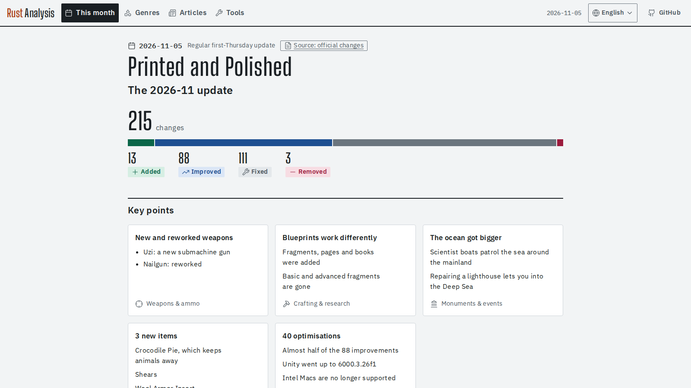
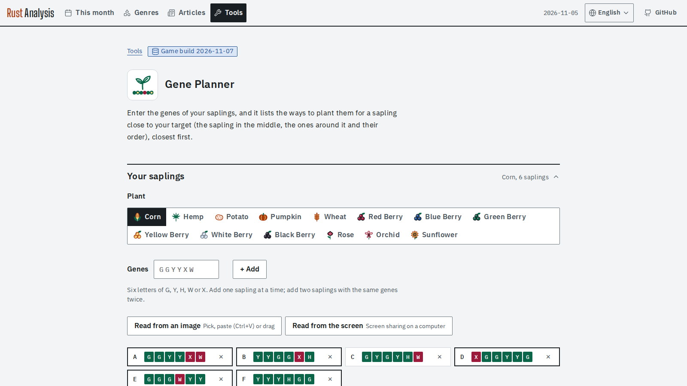
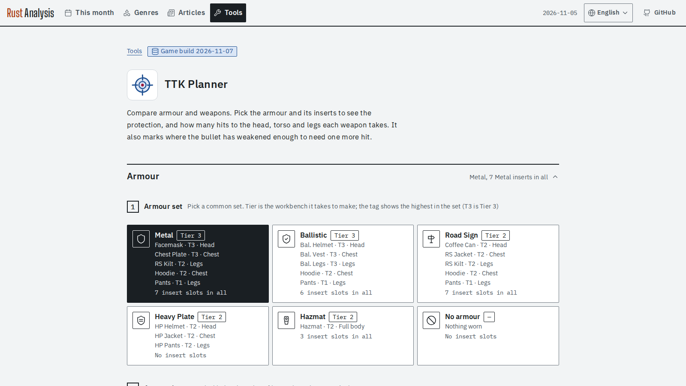
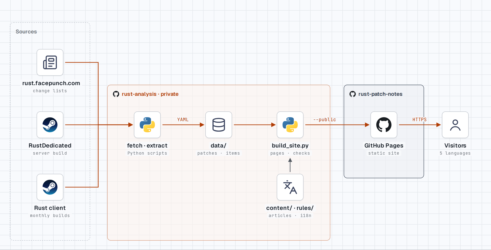

<a href="https://maco165.github.io/rust-patch-notes/en/index.html"><picture><source media="(prefers-color-scheme: dark)" srcset="assets/readme/hero-en-dark.png"></picture></a>

    

<b><a href="https://maco165.github.io/rust-patch-notes/en/index.html">https://maco165.github.io/rust-patch-notes/</a></b>

An unofficial, one-person site about the game Rust (Facepunch Studios): the official change lists summarised in Japanese, the values of every item, and five calculators (raiding, crafting, plant genes, teas and pies, hits to kill). This month, genres, the tools and the articles are in five languages.

## About this site

**What** — An unofficial analysis site that reads the official change lists and the game's own data and code to check how Rust works.

**Why** — No site summed up the updates and the inner workings of the game from the changes in its code.

**Strengths**

- Read down to the code: not only the values but the server's code (IL) is read to confirm the rules, and the calculators are tested against worked examples and exhaustive checks
- Every update since 2015, refreshed monthly: every patch since 2015, and the item settings compared build by build
- Five languages, just a browser, free: Japanese, English, Chinese, Korean and Russian, no sign-up and no ads, everything runs in your browser

**Principle** — Only what has been checked is written. Anything not checked is marked as not confirmed.

**Review** — Every change is checked as a diff by Claude, Anthropic's AI, and approved by a person before it goes public.

## Screens

<table><tr><td colspan="2" valign="top"> <b>This month</b></td></tr><tr><td width="50%" valign="top"> <b>Raid Planner</b></td><td width="50%" valign="top"> <b>Gene Planner</b></td></tr><tr><td width="50%" valign="top"> <b>Buff Planner</b></td><td width="50%" valign="top"> <b>TTK Planner</b></td></tr></table>

## System structure

The pages are built by Python scripts from data read out of the game. There are no external JS files: `build_site.py` writes each page's script into the page.

<picture><source media="(prefers-color-scheme: dark)" srcset="assets/readme/arch-dark.png"></picture>

- Every page links to every top-level page through the header nav.
- `tools/raid.html` passes the picked counts to `tools/craft.html` in the URL (`m`, `o`, `c`, `r`); the craft page links back with `r`.
- `assets/style.css` is `design/tokens.json` as CSS variables, then `components.css`, `site.css` and one mask per icon in `item-icons/`.

## Pages

| Page | What it shows | Drawn from |
|---|---|---|
| [index.html](en/index.html) | This month's update: key points, counts, changed numbers, every change | The official change lists, rewritten in Japanese |
| [history.html](history.html) (Japanese only) · [genres.html](en/genres.html) · [numbers.html](numbers.html) (Japanese only) | Every patch, filtered by genre, year and kind; counts per genre; changes that state numbers | The same change lists; the genres are this site's own rules |
| [items.html](items.html) (Japanese only) · [spec.html](spec.html) (Japanese only) | Each item's settings, where it drops and how often; all values as tables | Values exported from the server build, and odds worked out from its loot tables |
| [diffs.html](diffs.html) (Japanese only) | What changed in the item settings between two builds | The item files of the client's monthly builds |
| [columns.html](en/columns.html) | Articles that check what players say against the server's code and data | The server's code (IL) and data; sources at the end of each article |
| [tools/raid.html](en/tools/raid.html) | Raid Planner: explosives, sulfur, materials and furnace time to break walls, doors and deployables together | Server data, and the damage and smelting rules read from the server's code |
| [tools/craft.html](en/tools/craft.html) | Craft Planner: what is still missing and how long the furnaces take, from what you make, what you hold and your furnaces | The same data as the Raid Planner |
| [tools/gene.html](en/tools/gene.html) | Gene Planner: how to plant your saplings to get genes close to a target such as GGGYYY, and what the genes do | Server data, and the crossbreeding rules read from the server's code |
| [tools/buff.html](en/tools/buff.html) | Buff Planner: how strong the effects of teas and pies are and until when, what replaces what, and what the Bear Pie makes shorter | Server data, and the stacking rules read from the server's code |
| [tools/ttk.html](en/tools/ttk.html) | TTK Planner: protection per body part from armour and inserts, and how many hits each gun and bow needs to the head, torso and legs, every 10 m | Server data, and the damage formula read from the server's code |

## Languages

This month, genres, the tools and the articles are in Japanese, English, Chinese (Simplified), Korean and Russian; the other pages (and this month's list of every change) are in Japanese only. These pages open in your browser's language the first time (a language you pick with the language links is kept). Item names are the game's English names in every language. The change lists are the official English text put into Japanese, so they will not be translated back: read https://rust.facepunch.com/changes.

| Language | Status |
|---|---|
| 日本語 | Every page |
| English | This month, genres, tools, articles and this README |
| 简体中文 | This month, genres, tools, articles and README |
| 한국어 | This month, genres, tools, articles and README |
| Русский | This month, genres, tools, articles and README |

## Good to know

- Not affiliated with Facepunch Studios.
- The values are read from the game's data and code, not measured in the game. No guarantee that they are right.
- This repository holds only the generated pages. Do not edit them by hand.
- Some icons are from [Lucide](https://lucide.dev/) (ISC License, `LICENSE-lucide.txt`). No icons or images of the game are used.
- The logos in the diagram are trademarks of their owners (icons: svgl, Lucide; drawn with stack-diagram).

## About the game Rust

Rust is a multiplayer survival game by Facepunch Studios. You start on a beach with nothing but a rock, gather resources, craft tools, build a base, and team up with or fight other players. It entered Early Access in 2013 and was fully released in 2018. A big update lands on the first Thursday of every month, and this site follows those changes. The PC version is on Steam; Rust Console Edition is available for PlayStation and Xbox.

 &nbsp; <a href="https://rust.facepunch.com/">Official site: rust.facepunch.com</a>

