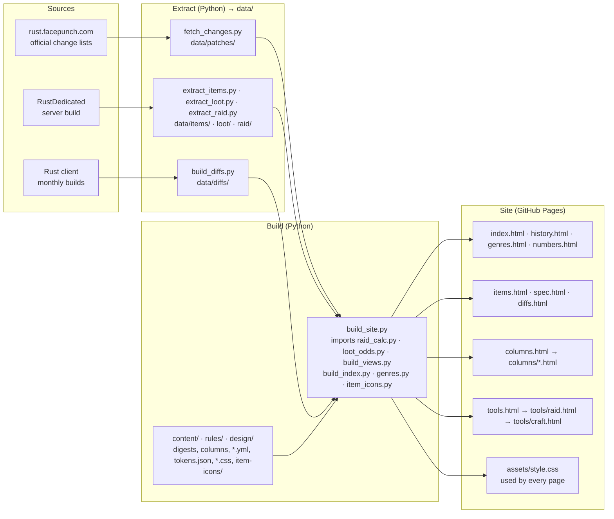

[日本語](README.md) | **English**

# Rust Analysis

An unofficial, one-person site about the game Rust (Facepunch Studios): the official change lists summarised in
Japanese, the values of every item, and calculators for raiding and crafting.

**https://maco165.github.io/rust-patch-notes/**

## System structure

The pages are built by Python scripts from data read out of the game. There are no external JS files: `build_site.py`
writes each page's script into the page.

- Every page links to every top-level page through the header nav.
- `tools/raid.html` passes the picked counts to `tools/craft.html` in the URL (`m`, `o`, `c`, `r`); the craft page links back with `r`.
- `assets/style.css` is `design/tokens.json` as CSS variables, then `components.css`, `site.css` and one mask per icon in `item-icons/`.

## Pages

| Page | What it shows | Drawn from |
|---|---|---|
| [index.html](index.html) | This month's update: key points, counts, changed numbers, every change | The official change lists, rewritten in Japanese |
| [history.html](history.html) · [genres.html](genres.html) · [numbers.html](numbers.html) | Every patch, filtered by genre, year and kind; counts per genre; changes that state numbers | The same change lists; the genres are this site's own rules |
| [items.html](items.html) · [spec.html](spec.html) | Each item's settings, where it drops and how often; all values as tables | Values exported from the server build, and odds worked out from its loot tables |
| [diffs.html](diffs.html) | What changed in the item settings between two builds | The item files of the client's monthly builds |
| [columns.html](columns.html) | Articles that check what players say against the server's code and data | The server's code (IL) and data; sources at the end of each article |
| [tools/raid.html](tools/raid.html) | Raid Planner: explosives, sulfur, materials and furnace time to break walls, doors and deployables together | Server data, and the damage and smelting rules read from the server's code |
| [tools/craft.html](tools/craft.html) | Craft Planner: what is still missing and how long the furnaces take, from what you make, what you hold and your furnaces | The same data as the Raid Planner |

## Languages

The site is in Japanese for now. The tools and the articles come first in other languages. The change lists are the
official English text put into Japanese, so they will not be translated back: read https://rust.facepunch.com/changes.

| Language | Status |
|---|---|
| 日本語 | Available |
| English | In preparation |
| 简体中文 | Planned — 计划支持。 |
| 한국어 | Planned — 지원할 예정입니다. |
| Русский | Planned — Планируется поддержка. |

## Good to know

- Not affiliated with Facepunch Studios.
- The values are read from the game's data and code, not measured in the game. No guarantee that they are right.
- This repository holds only the generated pages. Do not edit them by hand.
- Some icons are from [Lucide](https://lucide.dev/) (ISC License, `LICENSE-lucide.txt`). No icons or images of the game are used.
