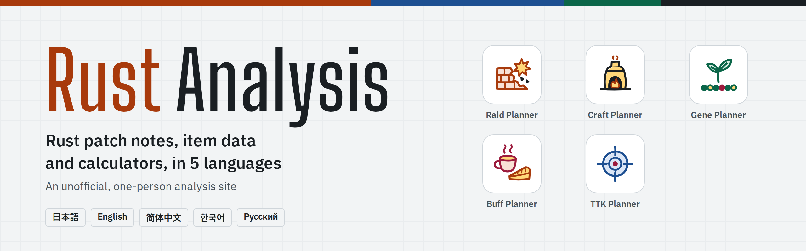
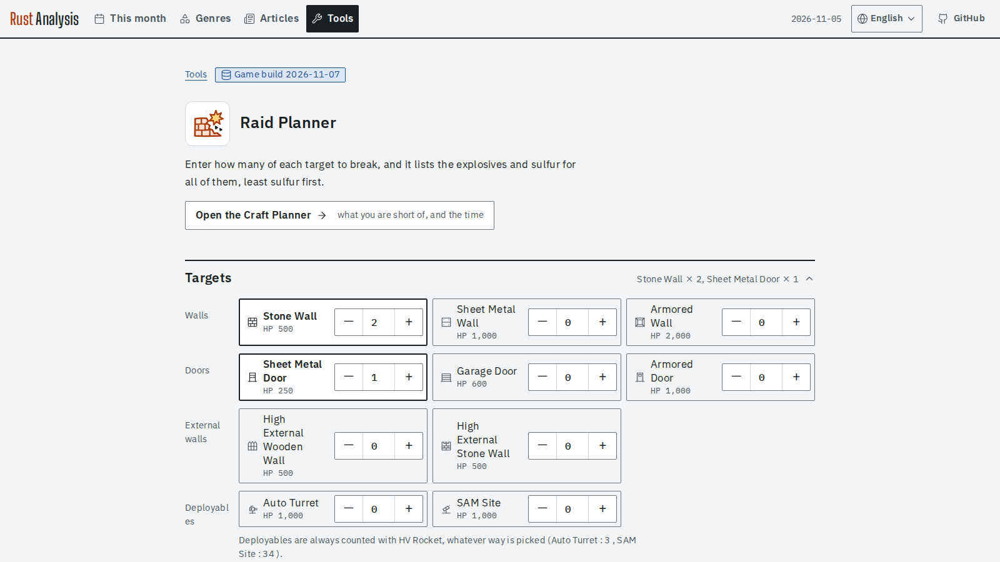
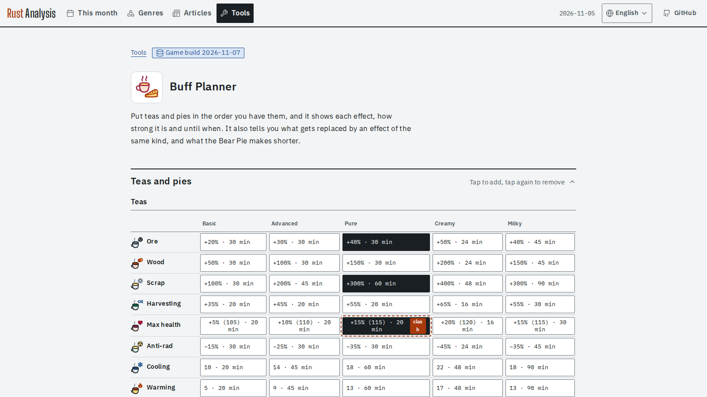
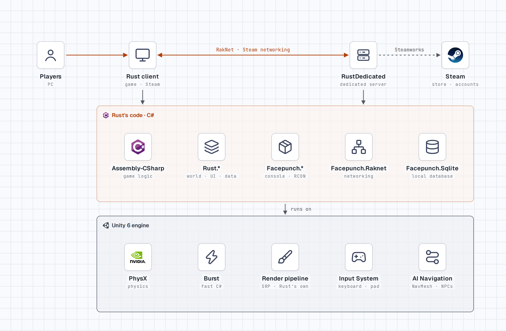

<a href="https://maco165.github.io/rust-patch-notes/en/index.html"><picture><source media="(prefers-color-scheme: dark)" srcset="assets/readme/hero-en-dark.png"></picture></a>

    

<b><a href="https://maco165.github.io/rust-patch-notes/en/index.html">https://maco165.github.io/rust-patch-notes/</a></b>

An unofficial, one-person site about the game Rust (Facepunch Studios): the official change lists summarised in Japanese, the values of every item, and five calculators (raiding, crafting, plant genes, teas and pies, hits to kill). This month, genres, the tools and the articles are in five languages.

## About this site

**What** — An unofficial analysis site that sums up what changed in each Rust update and how the game works, with the numbers.

**Why** — No site summed up the updates and the inner workings of the game from the changes in its code.

**Strengths**

- Tested calculators: the raid, crossbreeding, tea and food, and shots-to-kill calculators are tested against worked examples and exhaustive checks
- Every update since 2015, refreshed monthly: every patch since 2015, and the item settings compared build by build
- Five languages, just a browser, free: Japanese, English, Chinese, Korean and Russian, no sign-up and no ads, everything runs in your browser

**Principle** — Only what has been checked is written. Anything not checked is marked as not confirmed.

**Review** — Every change is checked as a diff by Claude, Anthropic's AI, and approved by a person before it goes public.

## Pages

| Page | What it shows | Languages |
|---|---|---|
| [This month](https://maco165.github.io/rust-patch-notes/en/index.html) | key points, counts, genres and item setting changes of this month's update | JP EN CN KR RU |
| [History](https://maco165.github.io/rust-patch-notes/history.html) | every change since 2015, filtered by genre, year, kind and words | JP only |
| [Genres](https://maco165.github.io/rust-patch-notes/en/genres.html) | changes per genre and how they moved year by year | JP EN CN KR RU |
| [Numbers](https://maco165.github.io/rust-patch-notes/numbers.html) | changes whose official text states values before and after, or rates | JP only |
| [Build diffs](https://maco165.github.io/rust-patch-notes/diffs.html) | pick two builds to see how many item settings changed | JP only |
| [Items](https://maco165.github.io/rust-patch-notes/items.html) | each item's settings, where it drops and how often, and its change history | JP only |
| [Spec sheet](https://maco165.github.io/rust-patch-notes/spec.html) | every item's values in tables by type | JP only |
| [Articles](https://maco165.github.io/rust-patch-notes/en/columns.html) | what players say, checked against the server's code and data | JP EN CN KR RU |

### Tools

| Tool | What it does | Languages |
|---|---|---|
| [Raid Planner](https://maco165.github.io/rust-patch-notes/en/tools/raid.html) | explosives, sulfur and materials to break walls, doors and deployables together | JP EN CN KR RU |
| [Craft Planner](https://maco165.github.io/rust-patch-notes/en/tools/craft.html) | what you still need and the furnace time, from what you make and what you hold | JP EN CN KR RU |
| [Gene Planner](https://maco165.github.io/rust-patch-notes/en/tools/gene.html) | how to plant your saplings to get close to the genes you want | JP EN CN KR RU |
| [Buff Planner](https://maco165.github.io/rust-patch-notes/en/tools/buff.html) | how teas and pies stack and when they run out | JP EN CN KR RU |
| [TTK Planner](https://maco165.github.io/rust-patch-notes/en/tools/ttk.html) | hits to kill for each armour and weapon | JP EN CN KR RU |

## Screens

<table><tr><td colspan="2" valign="top"> <b>This month</b></td></tr><tr><td width="50%" valign="top"> <b>Raid Planner</b></td><td width="50%" valign="top"> <b>Gene Planner</b></td></tr><tr><td width="50%" valign="top"> <b>Buff Planner</b></td><td width="50%" valign="top"> <b>TTK Planner</b></td></tr></table>

## System structure

<picture><source media="(prefers-color-scheme: dark)" srcset="assets/readme/arch-dark.png"></picture>

## Languages

This month, genres, the tools and the articles are in Japanese, English, Chinese (Simplified), Korean and Russian; the other pages (and this month's list of every change) are in Japanese only. These pages open in your browser's language the first time (a language you pick with the language links is kept). Item names are the game's English names in every language. The change lists are the official English text put into Japanese, so they will not be translated back: read https://rust.facepunch.com/changes.

## Good to know

- Not affiliated with Facepunch Studios.
- The values are read from the game's data and code, not measured in the game. No guarantee that they are right.
- This repository holds only the generated pages. Do not edit them by hand.
- Some icons are from [Lucide](https://lucide.dev/) (ISC License, `LICENSE-lucide.txt`). No icons or images of the game are used.
- The logos in the diagram are trademarks of their owners (icons: svgl, Lucide; drawn with stack-diagram).

## About the game Rust

Rust is a multiplayer survival game by Facepunch Studios. You start on a beach with nothing but a rock, gather resources, craft tools, build a base, and team up with or fight other players. It entered Early Access in 2013 and was fully released in 2018. The game and its server are written in C# on the Unity engine. A big update lands on the first Thursday of every month, and this site follows those changes. The PC version is on Steam; Rust Console Edition is available for PlayStation and Xbox.

### What it runs on

<picture><source media="(prefers-color-scheme: dark)" srcset="assets/readme/engine-dark.png"></picture>

The game and the server are C# programs on Unity 6. Checked against the C# assemblies (DLLs) of the dedicated server (RustDedicated, build of 2026-10-22); the Unity version is from the official change list (2026-11-05: 6000.3.26f1).

### Official links

- [Official site: rust.facepunch.com](https://rust.facepunch.com/)
- [Update notes (official changes)](https://rust.facepunch.com/changes)
- [News](https://rust.facepunch.com/news)
- [Development commit log](https://commits.facepunch.com/r/rust_reboot)

