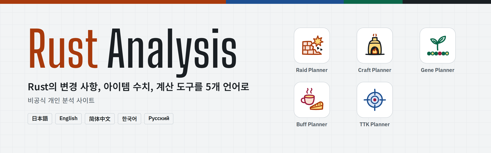
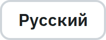
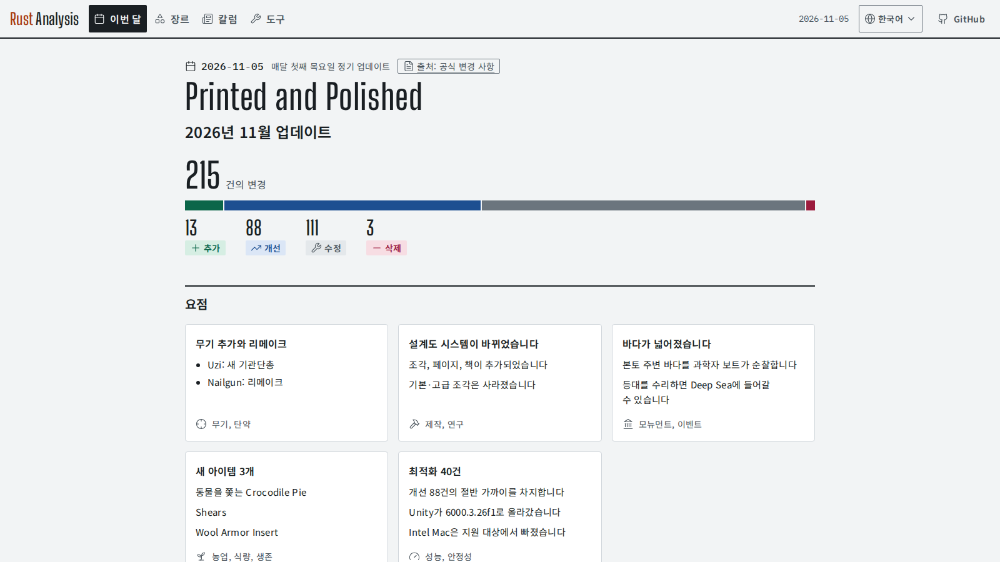
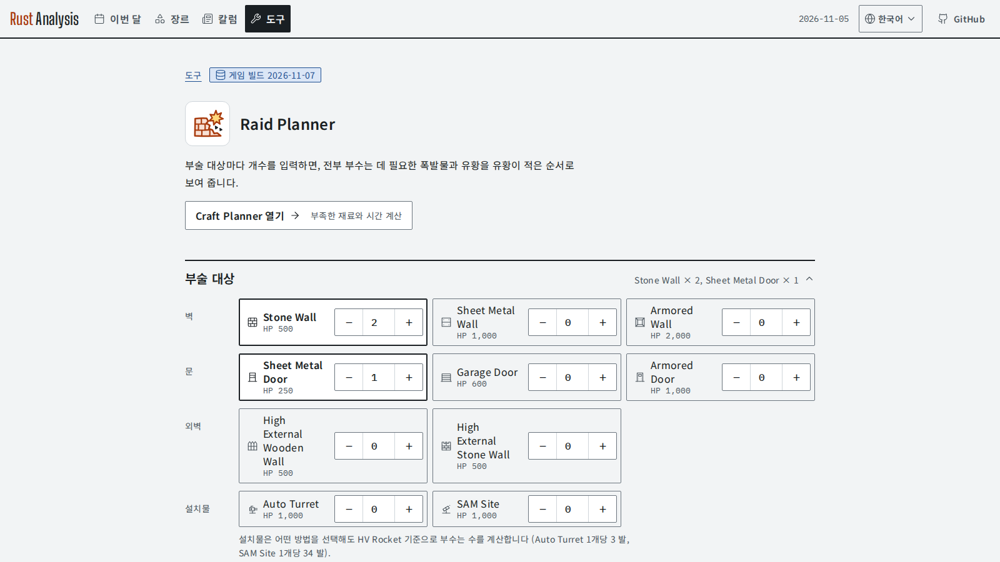
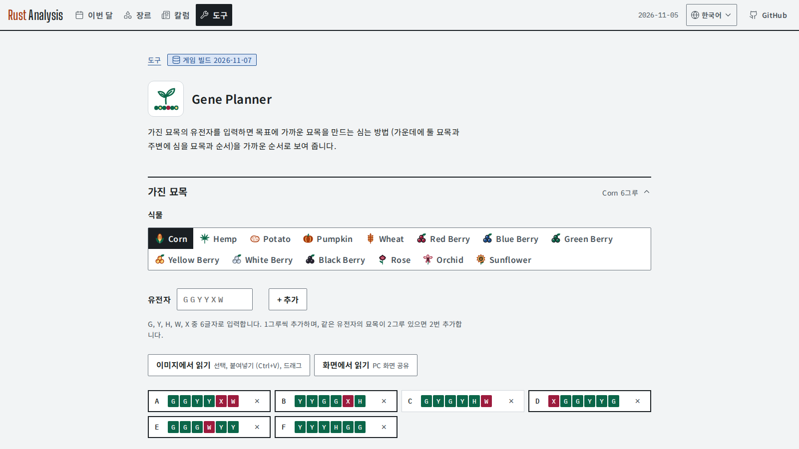
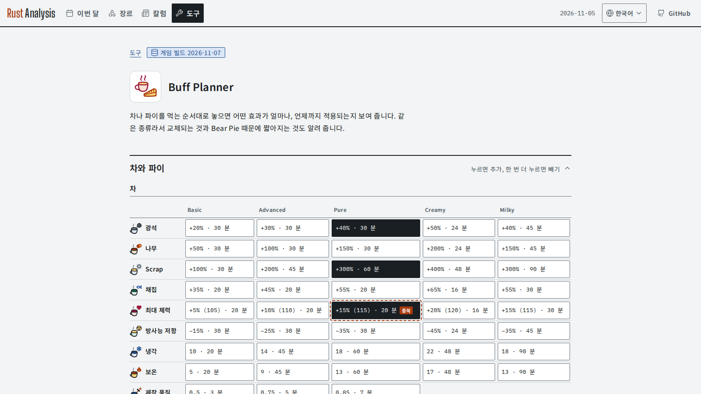
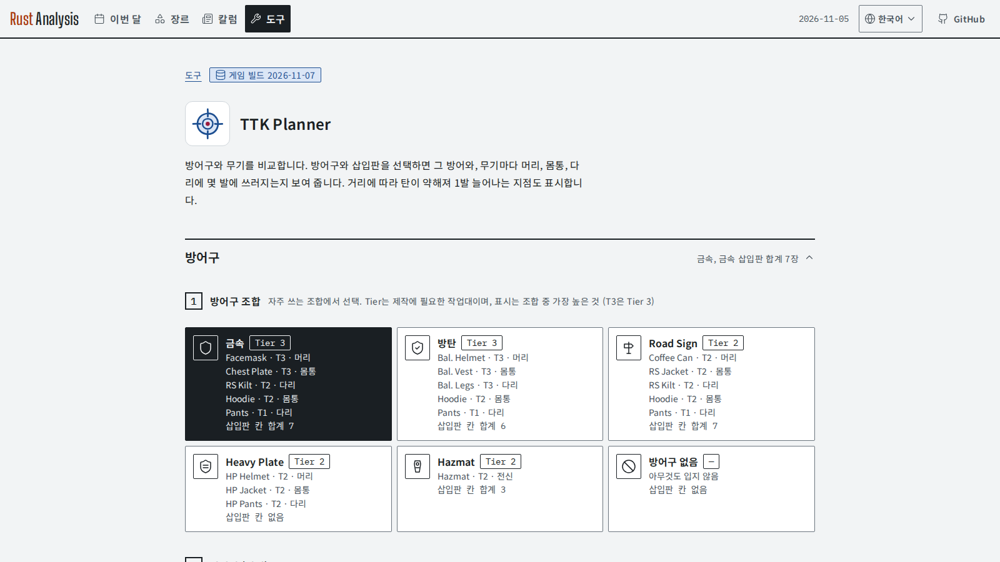
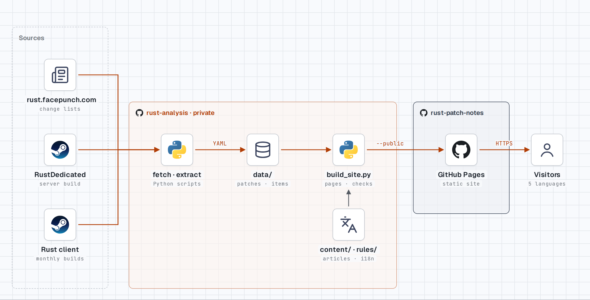

<a href="https://maco165.github.io/rust-patch-notes/ko/index.html"><picture><source media="(prefers-color-scheme: dark)" srcset="assets/readme/hero-ko-dark.png"></picture></a>

    

<b><a href="https://maco165.github.io/rust-patch-notes/ko/index.html">https://maco165.github.io/rust-patch-notes/</a></b>

게임 Rust (Facepunch Studios)에 관한 비공식 개인 사이트입니다. 공식 변경 사항을 일본어로 정리하고, 모든 아이템의 수치와 계산기 5개 (레이드, 제작, 식물 유전자, 차와 파이, 몇 발에 쓰러지는지)를 제공합니다. 이번 달, 장르, 도구, 글은 5개 언어로 볼 수 있습니다.

## 이 사이트에 대해

**무엇인가** — 공식 변경 사항과 게임 본체의 데이터와 코드를 읽어 Rust의 작동 방식을 확인하는 비공식 분석 사이트입니다.

**왜 만들었나** — 게임 코드의 변경에서 업데이트 내용과 내부 구조를 정리한 사이트가 없었기 때문입니다.

**강점**

- 코드까지 읽고 확인: 수치만이 아니라 서버 코드 (IL)를 읽어 계산 규칙을 확인하고, 계산기는 예제와 전수 검사로 검증합니다
- 2015년부터의 전체 기록과 매달 업데이트: 2015년부터의 모든 변경 사항과 월별 판의 아이템 설정 차이
- 5개 언어, 브라우저만, 무료: 일본어, 영어, 중국어, 한국어, 러시아어로 볼 수 있고, 가입도 광고도 없이 브라우저 안에서만 작동합니다

**원칙** — 확인한 것만 씁니다. 확인하지 않은 것은 '미확인'이라고 씁니다.

**검토** — 모든 변경은 공개 전에 Anthropic의 AI 'Claude'가 차이를 확인하고 사람이 승인합니다.

## 화면

<table><tr><td colspan="2" valign="top"> <b>이번 달</b></td></tr><tr><td width="50%" valign="top"> <b>Raid Planner</b></td><td width="50%" valign="top"> <b>Gene Planner</b></td></tr><tr><td width="50%" valign="top"> <b>Buff Planner</b></td><td width="50%" valign="top"> <b>TTK Planner</b></td></tr></table>

## 시스템 구성

페이지는 게임에서 읽어 낸 데이터로 Python 스크립트가 만듭니다. 외부 JS 파일은 없으며, `build_site.py`가 각 페이지의 스크립트를 페이지 안에 직접 씁니다.

<picture><source media="(prefers-color-scheme: dark)" srcset="assets/readme/arch-dark.png"></picture>

- 모든 페이지에서 상단 메뉴로 주요 페이지 전체에 갈 수 있습니다.
- `tools/raid.html`은 고른 개수를 URL (`m`, `o`, `c`, `r`)로 `tools/craft.html`에 넘깁니다. 제작 페이지는 `r`로 되돌아가는 링크를 만듭니다.
- `assets/style.css`는 `design/tokens.json`을 CSS 변수로 바꾼 것에 `components.css`, `site.css`, `item-icons/`의 아이콘 마스크를 더한 것입니다.

## 페이지

| 페이지 | 내용 | 근거 |
|---|---|---|
| [index.html](ko/index.html) | 이번 달 업데이트: 요점, 건수, 수치 변화, 전체 변경 | 공식 변경 사항을 일본어로 다시 쓴 것 |
| [history.html](history.html) (일본어만) · [genres.html](ko/genres.html) · [numbers.html](numbers.html) (일본어만) | 모든 패치 (장르·연도·종류로 필터); 장르별 건수; 수치가 적힌 변경 | 같은 변경 사항; 장르 분류는 이 사이트의 규칙 |
| [items.html](items.html) (일본어만) · [spec.html](spec.html) (일본어만) | 아이템별 설정, 드롭 위치와 확률; 모든 수치의 표 | 서버 빌드에서 내보낸 수치와, 루팅 표로 계산한 확률 |
| [diffs.html](diffs.html) (일본어만) | 두 빌드 사이에 바뀐 아이템 설정 | 클라이언트 월별 빌드의 아이템 파일 |
| [columns.html](ko/columns.html) | 플레이어들의 말을 서버 코드와 데이터로 확인하는 글 | 서버의 코드 (IL)와 데이터; 출처는 각 글의 끝 |
| [tools/raid.html](ko/tools/raid.html) | Raid Planner: 벽·문·설치물을 함께 부수는 데 필요한 폭발물, 유황, 재료와 화로 시간 | 서버 데이터와, 서버 코드에서 읽은 피해·제련 규칙 |
| [tools/craft.html](ko/tools/craft.html) | Craft Planner: 만들 것, 가진 자원, 화로로부터 부족한 것과 화로 시간 | Raid Planner와 같은 데이터 |
| [tools/gene.html](ko/tools/gene.html) | Gene Planner: 가진 모종으로 GGGYYY 같은 목표에 가까운 유전자를 얻는 심는 법과 유전자의 효과 | 서버 데이터와, 서버 코드에서 읽은 교배 규칙 |
| [tools/buff.html](ko/tools/buff.html) | Buff Planner: 차와 파이의 효과가 얼마나 강하고 언제까지 가는지, 무엇이 교체되는지, 곰고기 파이가 무엇을 짧게 하는지 | 서버 데이터와, 서버 코드에서 읽은 중첩 규칙 |
| [tools/ttk.html](ko/tools/ttk.html) | TTK Planner: 방어구와 삽입판으로 부위별 방어, 총과 활마다 머리·몸통·다리에 몇 발에 쓰러지는지 10 m마다 | 서버 데이터와, 서버 코드에서 읽은 피해 공식 |

## 언어

이번 달, 장르, 도구, 글은 일본어, 영어, 중국어(간체), 한국어, 러시아어로 볼 수 있고, 다른 페이지(와 이번 달의 전체 변경 목록)는 일본어뿐입니다. 이 페이지들은 처음 열 때 브라우저 언어의 판으로 이동합니다(언어 링크로 고르면 그 언어를 기억합니다). 아이템 이름은 모든 언어에서 게임의 영어 이름입니다. 변경 사항은 공식 영어 문장을 일본어로 옮긴 것이라 다른 언어로 옮기지 않습니다. https://rust.facepunch.com/changes 를 보세요.

| 언어 | 상태 |
|---|---|
| 日本語 | 모든 페이지 |
| English | 이번 달, 장르, 도구, 글, README |
| 简体中文 | 이번 달, 장르, 도구, 글, README |
| 한국어 | 이번 달, 장르, 도구, 글, 이 README |
| Русский | 이번 달, 장르, 도구, 글, README |

## 알아 둘 점

- Facepunch Studios와 관계가 없습니다.
- 수치는 게임의 데이터와 코드에서 읽은 것이며, 게임 안에서 측정한 것이 아닙니다. 정확함을 보장하지 않습니다.
- 이 저장소에는 생성된 페이지만 있습니다. 직접 고치지 마세요.
- 일부 아이콘은 [Lucide](https://lucide.dev/) (ISC License, `LICENSE-lucide.txt`)입니다. 게임의 아이콘이나 이미지는 쓰지 않았습니다.
- 구성도의 로고는 각 소유자의 상표입니다 (아이콘: svgl, Lucide. stack-diagram으로 작성).

## 게임 Rust 소개

Rust는 Facepunch Studios가 개발한 멀티플레이 생존 게임입니다. 돌 하나만 든 채 해변에서 시작해 자원을 모으고, 도구를 만들고, 기지를 지으며 다른 플레이어와 협력하거나 빼앗습니다. 2013년에 앞서 해보기로 시작해 2018년에 정식 출시되었습니다. 매달 첫째 목요일에 큰 업데이트가 있으며, 이 사이트는 그 변화를 따라갑니다. PC판은 Steam에서, PlayStation과 Xbox용으로는 Rust Console Edition이 있습니다.

 &nbsp; <a href="https://rust.facepunch.com/">공식 사이트: rust.facepunch.com</a>

