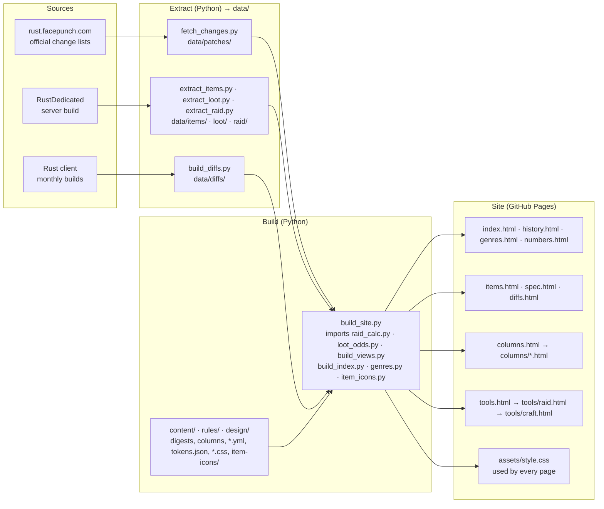

[日本語](README.md) | [English](README.en.md) | [简体中文](README.zh.md) | **한국어** | [Русский](README.ru.md)

# Rust Analysis

게임 Rust (Facepunch Studios)에 관한 비공식 개인 사이트입니다. 공식 변경 사항을 일본어로 정리하고, 모든 아이템의 수치와 레이드·제작 계산기를 제공합니다.

**https://maco165.github.io/rust-patch-notes/**

## 시스템 구성

페이지는 게임에서 읽어 낸 데이터로 Python 스크립트가 만듭니다. 외부 JS 파일은 없으며, `build_site.py`가 각 페이지의 스크립트를 페이지 안에 직접 씁니다.

- 모든 페이지에서 상단 메뉴로 주요 페이지 전체에 갈 수 있습니다.
- `tools/raid.html`은 고른 개수를 URL (`m`, `o`, `c`, `r`)로 `tools/craft.html`에 넘깁니다. 제작 페이지는 `r`로 되돌아가는 링크를 만듭니다.
- `assets/style.css`는 `design/tokens.json`을 CSS 변수로 바꾼 것에 `components.css`, `site.css`, `item-icons/`의 아이콘 마스크를 더한 것입니다.

## 페이지

| 페이지 | 내용 | 근거 |
|---|---|---|
| [index.html](index.html) (일본어만) | 이번 달 업데이트: 요점, 건수, 수치 변화, 전체 변경 | 공식 변경 사항을 일본어로 다시 쓴 것 |
| [history.html](history.html) · [genres.html](genres.html) · [numbers.html](numbers.html) (일본어만) | 모든 패치 (장르·연도·종류로 필터); 장르별 건수; 수치가 적힌 변경 | 같은 변경 사항; 장르 분류는 이 사이트의 규칙 |
| [items.html](items.html) · [spec.html](spec.html) (일본어만) | 아이템별 설정, 드롭 위치와 확률; 모든 수치의 표 | 서버 빌드에서 내보낸 수치와, 루팅 표로 계산한 확률 |
| [diffs.html](diffs.html) (일본어만) | 두 빌드 사이에 바뀐 아이템 설정 | 클라이언트 월별 빌드의 아이템 파일 |
| [columns.html](en/columns.html) (English) | 플레이어들의 말을 서버 코드와 데이터로 확인하는 글 | 서버의 코드 (IL)와 데이터; 출처는 각 글의 끝 |
| [tools/raid.html](en/tools/raid.html) (English) | Raid Planner: 벽·문·설치물을 함께 부수는 데 필요한 폭발물, 유황, 재료와 화로 시간 | 서버 데이터와, 서버 코드에서 읽은 피해·제련 규칙 |
| [tools/craft.html](en/tools/craft.html) (English) | Craft Planner: 만들 것, 가진 자원, 화로로부터 부족한 것과 화로 시간 | Raid Planner와 같은 데이터 |

## 언어

도구와 글은 일본어와 영어로 볼 수 있고, 다른 페이지는 일본어뿐입니다. 변경 사항은 공식 영어 문장을 일본어로 옮긴 것이라 다시 영어로 옮기지 않습니다. https://rust.facepunch.com/changes 를 보세요.

| 언어 | 상태 |
|---|---|
| 日本語 | 모든 페이지 |
| English | 도구, 글, 이 README |
| 简体中文 | 이 README; 페이지는 지원 예정 |
| 한국어 | 이 README; 페이지는 지원 예정 |
| Русский | 이 README; 페이지는 지원 예정 |

## 알아 둘 점

- Facepunch Studios와 관계가 없습니다.
- 수치는 게임의 데이터와 코드에서 읽은 것이며, 게임 안에서 측정한 것이 아닙니다. 정확함을 보장하지 않습니다.
- 이 저장소에는 생성된 페이지만 있습니다. 직접 고치지 마세요.
- 일부 아이콘은 [Lucide](https://lucide.dev/) (ISC License, `LICENSE-lucide.txt`)입니다. 게임의 아이콘이나 이미지는 쓰지 않았습니다.
