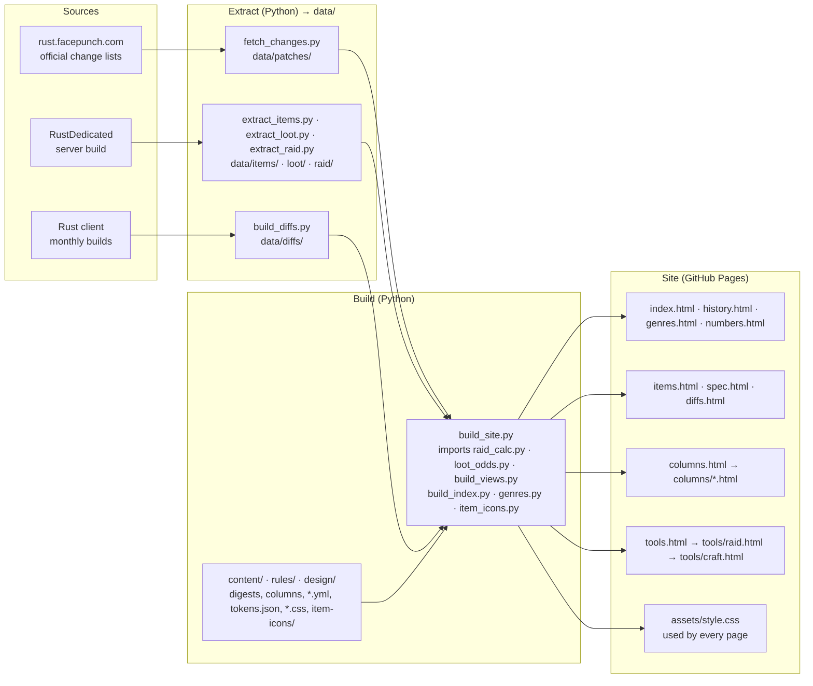

**日本語** | [English](README.en.md)

# Rust Analysis

ゲーム Rust (Facepunch Studios) の公式の変更点を日本語にまとめ、アイテムの値と、レイドやクラフトの計算機を置いた、個人の非公式のサイトです。

**https://maco165.github.io/rust-patch-notes/**

- Facepunch Studios とは関係がありません。
- 値はゲームのデータと処理を読んだもので、ゲームの中で測ったものではありません。正しさは保証しません。
- このリポジトリには、生成したページだけを置いています。ページを作る仕組みとデータは別の非公開のリポジトリにあります。
- アイコンの一部は [Lucide](https://lucide.dev/) (ISC License。`LICENSE-lucide.txt`) です。ゲームのアイコンや画像は使っていません。

## システム構成

ページは Python のスクリプトがデータから作ります。外部の JS ファイルは無く、各ページの JS は `build_site.py` がページの中に書き込みます。

- どのページも、上のメニューから全部の主なページへ行けます。
- `tools/raid.html` は、選んだ数を URL (`m`・`o`・`c`・`r`) で `tools/craft.html` に渡します。戻りのリンクは `r` で作ります。
- `assets/style.css` は、`design/tokens.json` を CSS の変数にしたものに、`components.css`・`site.css`・`item-icons/` のアイコンのマスクを足したものです。

## 言語 / Languages

サイトは、いまは日本語だけです。ツール (Raid Planner・Craft Planner) とコラムから順に、ほかの言語に対応していきます。変更点の一覧は公式の英語の文章を日本語にしたものなので、英語にはしません。

| 言語 | 状態 |
|---|---|
| 日本語 | 対応済み |
| English | 準備中 (README は [English](README.en.md) あり) — In preparation, starting with the tools and the articles. For the change lists, read the official page: https://rust.facepunch.com/changes |
| 简体中文 | 今後対応する予定 — 计划支持。 |
| 한국어 | 今後対応する予定 — 지원할 예정입니다. |
| Русский | 今後対応する予定 — Планируется поддержка. |

## 各ページが何を元に描かれているか

| ページ | 中身 | 元にしたもの |
|---|---|---|
| [index.html](index.html) | 今月のアップデートのまとめ (要点・件数・数値の変化・全件) と、先月の版とのアイテムの設定の差 | 公式の変更点の一覧 (https://rust.facepunch.com/changes、2026-11-05 まで) を自分の言葉で日本語にしたもの。アイテムの設定の差は、サーバー本体のデータの版 2026-10-22 と 2026-11-07 の比較 |
| [history.html](history.html) | これまでの全パッチの変更点 (ジャンル・年・分類・名前で絞り込み) | 公式の変更点の一覧 (https://rust.facepunch.com/changes、2026-11-05 まで) を自分の言葉で日本語にしたもの。ジャンルの振り分けはこのサイトの規則 |
| [genres.html](genres.html) | ジャンルごとの件数と年ごとの推移 | history.html と同じ変更点を、ジャンルごとに数えたもの |
| [numbers.html](numbers.html) | 公式の文章に前後の値や割合が書かれた変更 | 公式の変更点の文章に書かれた数字 (このサイトでは測っていない) |
| [diffs.html](diffs.html) | 2 つの版を選ぶと、その間にアイテムの設定がいくつ変わったか | ゲーム本体 (クライアント、Steam app 252490) の各月の版のアイテムの設定ファイル (2020-03 〜 2026-11 の 81 版)。版は Steam の manifest の番号で特定 |
| [items.html](items.html) | アイテムごとの今の設定、どの箱・NPC の死体から出るかと確率、変更の履歴 | 設定はサーバー本体 (RustDedicated) のデータから書き出した値 (版 2026-11-07)。出どころと確率は抽選の表 (版 2026-11-07) から計算したもの。変更の履歴は公式の変更点 |
| [spec.html](spec.html) | 全アイテムの値を種類ごとの表にしたもの | サーバー本体 (RustDedicated) のデータから書き出した値 (版 2026-11-07) |
| [columns.html](columns.html) | コラムの一覧 | 下の「コラム」の表 |
| [tools.html](tools.html) | ツールの一覧と、壊す物ごとの最安の爆発物の早見 | tools/raid.html と同じ計算 |
| [tools/craft.html](tools/craft.html) | 作る爆発物と手持ちの物資・炉の数から、足りない材料と炉の時間 | tools/raid.html と同じデータ |
| [tools/raid.html](tools/raid.html) | 壁・扉・外壁・設置物をまとめて壊すのに要る爆発物の数・硫黄・材料と、硫黄鉱石・木の数と炉の時間 | サーバー本体のデータ (建材・爆発物・炉、版 2026-11-07) と、ダメージと製錬の計算の仕方をサーバーの処理 (IL) から確かめた結果 |
| [en/tools.html](en/tools.html) | English の tools.html | tools.html と同じ計算。文言は content/i18n/en.yml から |
| [en/tools/craft.html](en/tools/craft.html) | English の tools/craft.html | tools/craft.html と同じ計算。文言は content/i18n/en.yml から |
| [en/tools/raid.html](en/tools/raid.html) | English の tools/raid.html | tools/raid.html と同じ計算。文言は content/i18n/en.yml から |

## コラム

ゲームの中で言われていることを、サーバーの処理とデータを読んで確かめた記事です (`columns/`)。記事の計算に使ったプログラムがあるものは、同じ名前の `.py` を置いています。

| 記事 | 日付 | 元にしたもの |
|---|---|---|
| [ルーレットに必勝パターンはあるのか](columns/wheel-myths.html) | 2026-11-12 | サーバーの処理 (IL) とデータ (版 2026-11-07)。出典 8 件は記事の末尾 |
| [スロットマシンは回すほど減る。戻りは平均 91.8%](columns/slot-machine.html) | 2026-11-12 | サーバーの処理 (IL) とデータ (版 2026-11-07)。出典 6 件は記事の末尾 |
| [箱の中身はいつ決まるのか](columns/loot-containers.html) | 2026-11-12 | サーバーの処理 (IL) とデータ (版 2026-11-07)。出典 4 件は記事の末尾 |
| [ブラックジャックとポーカーは、数えれば勝てるのか](columns/card-games.html) | 2026-11-12 | サーバーの処理 (IL) とデータ (版 2026-11-07)。出典 2 件は記事の末尾 |

## そのほか

- `assets/`: スタイル、ファビコン、共有用の画像
- `sitemap.xml`: 検索エンジン向けのページの一覧

ページと README はすべて生成物です。直接は編集せず、元のリポジトリで作り直して置き換えます。
