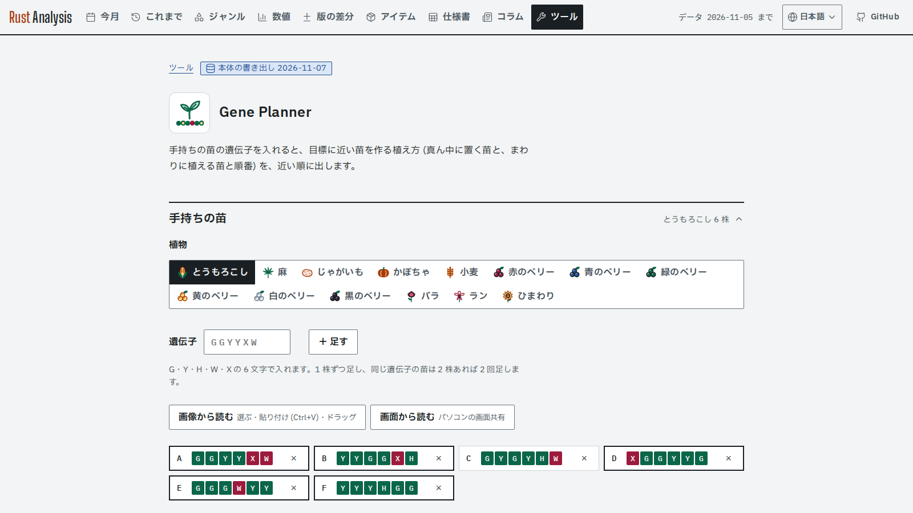
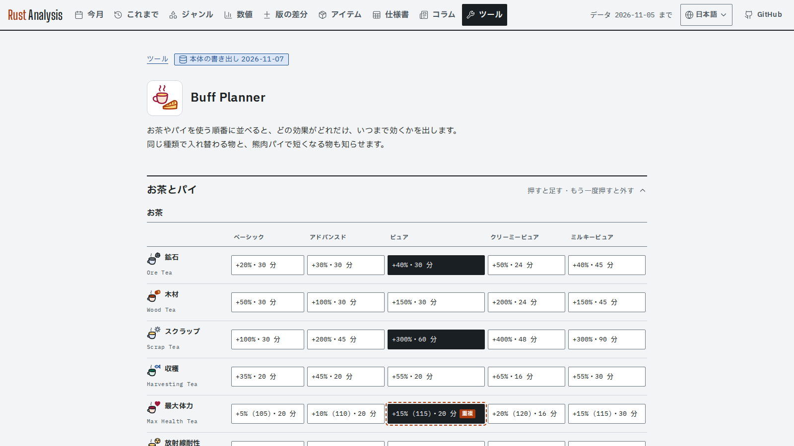
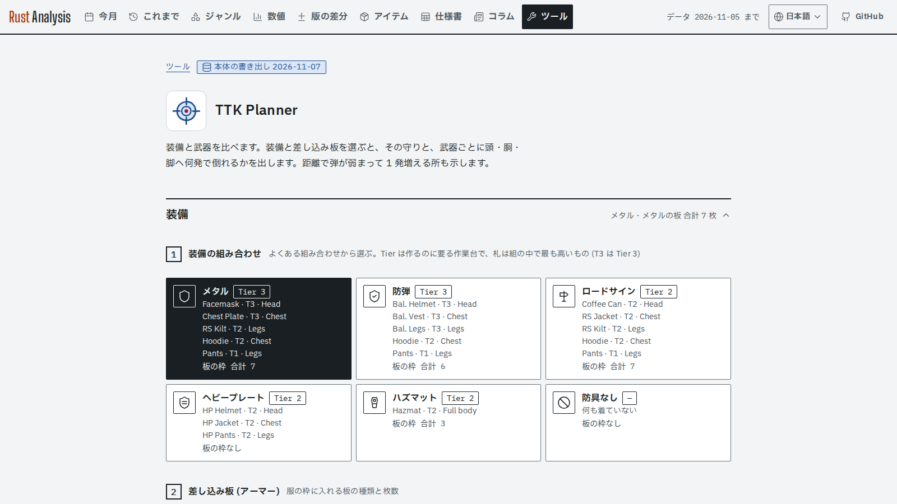
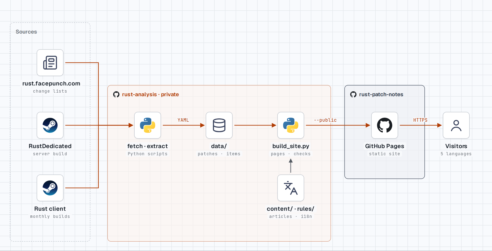
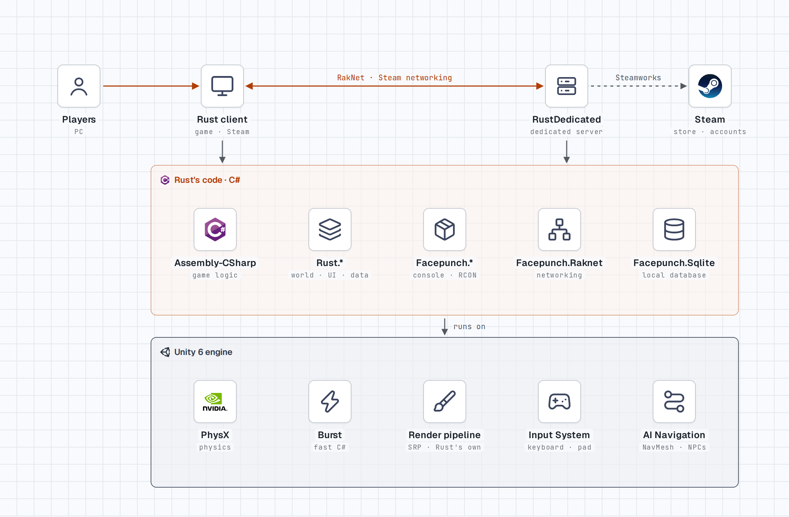

<a href="https://maco165.github.io/rust-patch-notes/"><picture><source media="(prefers-color-scheme: dark)" srcset="assets/readme/hero-ja-dark.png"></picture></a>

    

<b><a href="https://maco165.github.io/rust-patch-notes/">https://maco165.github.io/rust-patch-notes/</a></b>

ゲーム Rust (Facepunch Studios) の公式の変更点を日本語にまとめ、アイテムの値と、レイドやクラフト・遺伝子・お茶とパイ・何発で倒れるかの計算機を置いた、個人の非公式のサイトです。

## このサイトについて

**何か** — 公式の変更点と、ゲーム本体のデータと処理を読んで、Rust の仕組みを確かめる非公式の解析サイトです。

**なぜ作ったか** — ゲームのコードの変更から、アップデートの中身や内部の仕組みをまとめたサイトが無かったからです。

**強み**

- 処理まで読んで確かめる: 値だけでなくサーバーの処理 (IL) から計算の決まりを確かめ、計算機は例題と総当たりで検査しています
- 2015 年からの全履歴と毎月の更新: 2015 年からの全部の変更点と、月ごとの版のアイテムの設定の差
- 5 言語・ブラウザだけ・無料: 日本語・英語・中国語・韓国語・ロシア語で読め、登録も広告も無く、ブラウザの中だけで動きます

**考え方** — 確かめたことだけを書きます。確かめていないことは「未確認」と書きます。

**確認** — 変更は、公開の前に Anthropic の AI「Claude」が差分を確かめ、人が承認しています。

## 画面

<table><tr><td colspan="2" valign="top"> <b>今月</b></td></tr><tr><td width="50%" valign="top"> <b>Raid Planner</b></td><td width="50%" valign="top"> <b>Gene Planner</b></td></tr><tr><td width="50%" valign="top"> <b>Buff Planner</b></td><td width="50%" valign="top"> <b>TTK Planner</b></td></tr></table>

## システム構成

<picture><source media="(prefers-color-scheme: dark)" srcset="assets/readme/arch-dark.png"></picture>

## 言語

今月・ジャンル・ツール・コラムは日本語・英語・中国語 (簡体字)・韓国語・ロシア語で読め、初めて開いたときにブラウザの言語の版へ移ります。ほかのページは日本語だけで、アイテム名はどの言語でもゲームの英語名です。

## 注意

- Facepunch Studios とは関係がありません。値はゲームのデータと処理を読んだもので、正しさは保証しません。
- このリポジトリには生成したページだけを置いています。作る仕組みとデータは別の非公開のリポジトリにあります。
- アイコンの一部は [Lucide](https://lucide.dev/) (ISC License。`LICENSE-lucide.txt`) です。ゲームのアイコンや画像は使っていません。構成図のロゴは各社の商標です (アイコン: svgl・Lucide。図は stack-diagram で作成)。

## ゲーム Rust について

Rust は Facepunch Studios が開発した、マルチプレイのサバイバルゲームです。石ひとつだけを持って浜辺から始め、資源を集め、道具を作り、拠点を建てて、ほかのプレイヤーと協力したり奪い合ったりします。2013 年に早期アクセスで始まり、2018 年に正式リリースされました。ゲームとサーバーは、Unity エンジンの上で C# で作られています。毎月第 1 木曜日に大きなアップデートがあり、このサイトはその変化を追っています。PC 版は Steam で、PlayStation と Xbox 向けには Rust Console Edition があります。

### 何で動いているか

<picture><source media="(prefers-color-scheme: dark)" srcset="assets/readme/engine-dark.png"></picture>

ゲームとサーバーは、Unity 6 の上で動く C# のプログラムです。サーバー本体 (RustDedicated、2026-10-22 の版) の C# の部品 (DLL) から確かめた構成で、Unity の版は公式の変更点 (2026-11-05: 6000.3.26f1) によります。

### 公式のリンク

- [公式サイト: rust.facepunch.com](https://rust.facepunch.com/)
- [アップデート情報 (公式の変更点)](https://rust.facepunch.com/changes)
- [ニュース](https://rust.facepunch.com/news)
- [開発のコミットログ](https://commits.facepunch.com/r/rust_reboot)

