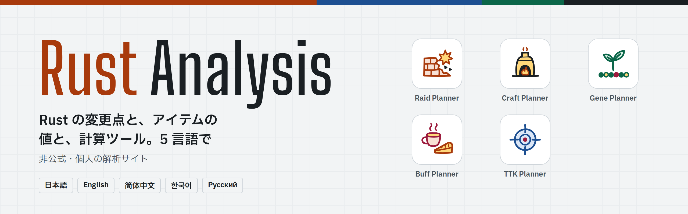
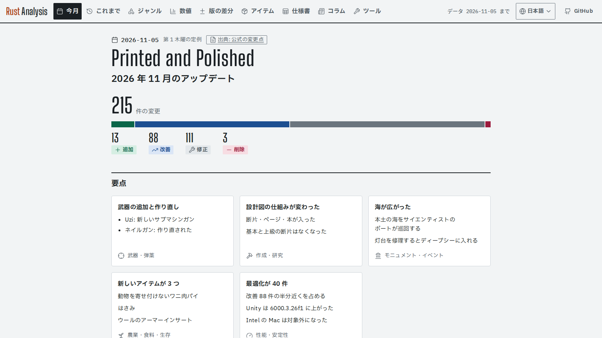
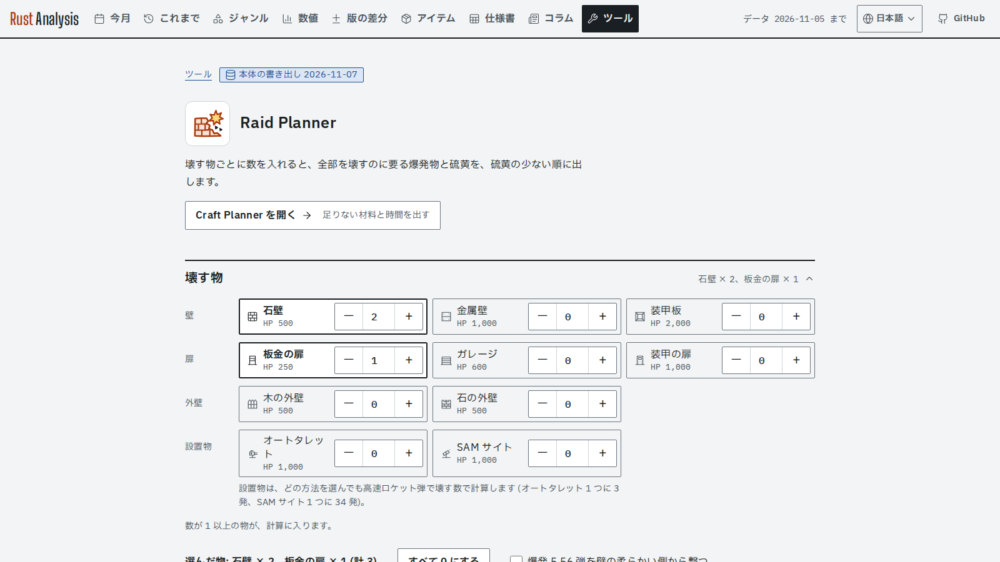

<a href="https://maco165.github.io/rust-patch-notes/"><picture><source media="(prefers-color-scheme: dark)" srcset="assets/readme/hero-ja-dark.png"></picture></a>

<b>日本語</b> · <a href="README.en.md">English</a> · <a href="README.zh.md">简体中文</a> · <a href="README.ko.md">한국어</a> · <a href="README.ru.md">Русский</a>

<b><a href="https://maco165.github.io/rust-patch-notes/">https://maco165.github.io/rust-patch-notes/</a></b>

ゲーム Rust (Facepunch Studios) の公式の変更点を日本語にまとめ、アイテムの値と、レイドやクラフト・遺伝子・お茶とパイ・何発で倒れるかの計算機を置いた、個人の非公式のサイトです。今月・ジャンル・ツール・コラムは 5 言語で読めます。

- Facepunch Studios とは関係がありません。
- 値はゲームのデータと処理を読んだもので、ゲームの中で測ったものではありません。正しさは保証しません。
- このリポジトリには、生成したページだけを置いています。ページを作る仕組みとデータは別の非公開のリポジトリにあります。
- アイコンの一部は [Lucide](https://lucide.dev/) (ISC License。`LICENSE-lucide.txt`) です。ゲームのアイコンや画像は使っていません。構成図のロゴは各社の商標です (アイコン: svgl・Lucide。図は stack-diagram で作成)。

## このサイトについて

**何か** — 公式の変更点と、ゲーム本体のデータと処理を読んで、Rust の仕組みを確かめる非公式の解析サイトです。

**なぜ作ったか** — ゲームのコードの変更から、アップデートの中身や内部の仕組みをまとめたサイトが無かったからです。

**強み**

- 処理まで読んで確かめる: 値だけでなくサーバーの処理 (IL) から計算の決まりを確かめ、計算機は例題と総当たりで検査しています
- 2015 年からの全履歴と毎月の更新: 2015 年からの全部の変更点と、月ごとの版のアイテムの設定の差
- 5 言語・ブラウザだけ・無料: 日本語・英語・中国語・韓国語・ロシア語で読め、登録も広告も無く、ブラウザの中だけで動きます

**考え方** — 確かめたことだけを書きます。確かめていないことは「未確認」と書きます。

## 画面

<table><tr><td colspan="2" valign="top"> <b>今月</b></td></tr><tr><td width="50%" valign="top"> <b>Raid Planner</b></td><td width="50%" valign="top"> <b>Gene Planner</b></td></tr><tr><td width="50%" valign="top"> <b>Buff Planner</b></td><td width="50%" valign="top"> <b>TTK Planner</b></td></tr></table>

## システム構成

ページは Python のスクリプトがデータから作ります。外部の JS ファイルは無く、各ページの JS は `build_site.py` がページの中に書き込みます。

<picture><source media="(prefers-color-scheme: dark)" srcset="assets/readme/arch-dark.png"></picture>

- どのページも、上のメニューから全部の主なページへ行けます。
- `tools/raid.html` は、選んだ数を URL (`m`・`o`・`c`・`r`) で `tools/craft.html` に渡します。戻りのリンクは `r` で作ります。
- `assets/style.css` は、`design/tokens.json` を CSS の変数にしたものに、`components.css`・`site.css`・`item-icons/` のアイコンのマスクを足したものです。

## 言語 / Languages

今月・ジャンル・ツール・コラムは日本語・英語・中国語 (簡体字)・韓国語・ロシア語、ほかのページは日本語だけです (今月の全変更点の一覧も日本語だけで、ほかの言語は件数と公式の一覧へのリンク)。これらのページは、初めて開いたときにブラウザの言語の版へ移ります (言語のリンクで選ぶと、その言語を覚えます)。アイテム名はどの言語でもゲームの英語名です。README は 5 言語あります。変更点の一覧は公式の英語の文章を日本語にしたものなので、ほかの言語にはしません。

| 言語 | 状態 |
|---|---|
| 日本語 | 対応済み |
| English | 今月・ジャンル・ツール・コラム。README は [English](README.en.md) — The tools and the articles are in English. For the change lists, read the official page: https://rust.facepunch.com/changes |
| 简体中文 | 今月・ジャンル・ツール・コラム。README は [简体中文](README.zh.md) |
| 한국어 | 今月・ジャンル・ツール・コラム。README は [한국어](README.ko.md) |
| Русский | 今月・ジャンル・ツール・コラム。README は [Русский](README.ru.md) |

## 各ページが何を元に描かれているか

| ページ | 中身 | 元にしたもの |
|---|---|---|
| [index.html](index.html) | 今月のアップデートのまとめ (要点・件数・数値の変化・全件) と、先月の版とのアイテムの設定の差 | 公式の変更点の一覧 (https://rust.facepunch.com/changes、2026-11-05 まで) を自分の言葉で日本語にしたもの。アイテムの設定の差は、サーバー本体のデータの版 2026-10-22 と 2026-11-07 の比較 |
| [history.html](history.html) | これまでの全パッチの変更点 (ジャンル・年・分類・名前で絞り込み) | 公式の変更点の一覧 (https://rust.facepunch.com/changes、2026-11-05 まで) を自分の言葉で日本語にしたもの。ジャンルの振り分けはこのサイトの規則 |
| [genres.html](genres.html) | ジャンルごとの件数と年ごとの推移 | history.html と同じ変更点を、ジャンルごとに数えたもの |
| [numbers.html](numbers.html) | 公式の文章に前後の値や割合が書かれた変更 | 公式の変更点の文章に書かれた数字 (このサイトでは測っていない) |
| [diffs.html](diffs.html) | 2 つの版を選ぶと、その間にアイテムの設定がいくつ変わったか | ゲーム本体 (クライアント、Steam app 252490) の各月の版のアイテムの設定ファイル (2020-03 〜 2026-11 の 81 版)。版は Steam の manifest の番号で特定 |
| [items.html](items.html) | アイテムごとの今の設定、どの箱・NPC の死体から出るかと確率、変更の履歴 | 設定はサーバー本体 (RustDedicated) のデータから書き出した値 (版 2026-11-07)。出どころと確率は抽選の表 (版 2026-11-07) から計算したもの。変更の履歴は公式の変更点 |
| [spec.html](spec.html) | 全アイテムの値を種類ごとの表にしたもの | サーバー本体 (RustDedicated) のデータから書き出した値 (版 2026-11-07) |
| [columns.html](columns.html) | コラムの一覧 | 下の「コラム」の表 |
| [tools.html](tools.html) | ツールの一覧と、壊す物ごとの最安の爆発物の早見 | tools/raid.html と同じ計算 |
| [tools/craft.html](tools/craft.html) | 作る爆発物と手持ちの物資・炉の数から、足りない材料と炉の時間 | tools/raid.html と同じデータ |
| [tools/gene.html](tools/gene.html) | 手持ちの苗から、目標に近い遺伝子の苗を作る植え方と、遺伝子の効き目 | サーバー本体のデータ (遺伝子の重み・植物・植木鉢) と、配合の決まりをサーバーの処理 (IL) から確かめた結果 |
| [tools/buff.html](tools/buff.html) | お茶とパイを使う順番から、効く効果の値と切れる時刻、入れ替わる物と熊肉パイで短くなる物 | サーバー本体のデータ (お茶とパイの効果、版 2026-11-07) と、効果の重なり方と値の使われ方をサーバーの処理 (IL) から確かめた結果 |
| [tools/ttk.html](tools/ttk.html) | 装備と差し込み板から部位ごとの守りと、銃と弓ごとに頭・胴・脚に何発で倒れるか、10 m ごとの発数 | サーバー本体のデータ (弾・武器・防具・部位の倍率、版 2026-11-07) と、ダメージの式をサーバーの処理 (IL) から確かめた結果 |
| [tools/raid.html](tools/raid.html) | 壁・扉・外壁・設置物をまとめて壊すのに要る爆発物の数・硫黄・材料と、硫黄鉱石・木の数と炉の時間 | サーバー本体のデータ (建材・爆発物・炉、版 2026-11-07) と、ダメージと製錬の計算の仕方をサーバーの処理 (IL) から確かめた結果 |
| [404.html](404.html) | 見つからないアドレスで出るページ (検索には載せない) | このサイトの文言 |
| [en/index.html](en/index.html) | English の index.html | index.html と同じ件数 (全件の一覧の代わりに分類ごとの件数と公式の一覧へのリンク)。要点は content/digests/en/、文言は content/i18n/en.yml から |
| [en/genres.html](en/genres.html) | English の genres.html | genres.html と同じ件数。文言は content/i18n/en.yml から |
| [en/tools.html](en/tools.html) | English の tools.html | tools.html と同じ計算。文言は content/i18n/en.yml から |
| [en/tools/raid.html](en/tools/raid.html) | English の tools/raid.html | tools/raid.html と同じ計算。文言は content/i18n/en.yml から |
| [en/tools/craft.html](en/tools/craft.html) | English の tools/craft.html | tools/craft.html と同じ計算。文言は content/i18n/en.yml から |
| [en/tools/gene.html](en/tools/gene.html) | English の tools/gene.html | tools/gene.html と同じ計算。文言は content/i18n/en.yml から |
| [en/tools/buff.html](en/tools/buff.html) | English の tools/buff.html | tools/buff.html と同じ計算。文言は content/i18n/en.yml から |
| [en/tools/ttk.html](en/tools/ttk.html) | English の tools/ttk.html | tools/ttk.html と同じ計算。文言は content/i18n/en.yml から |
| [zh/index.html](zh/index.html) | 简体中文 の index.html | index.html と同じ件数 (全件の一覧の代わりに分類ごとの件数と公式の一覧へのリンク)。要点は content/digests/zh/、文言は content/i18n/zh.yml から |
| [zh/genres.html](zh/genres.html) | 简体中文 の genres.html | genres.html と同じ件数。文言は content/i18n/zh.yml から |
| [zh/tools.html](zh/tools.html) | 简体中文 の tools.html | tools.html と同じ計算。文言は content/i18n/zh.yml から |
| [zh/tools/raid.html](zh/tools/raid.html) | 简体中文 の tools/raid.html | tools/raid.html と同じ計算。文言は content/i18n/zh.yml から |
| [zh/tools/craft.html](zh/tools/craft.html) | 简体中文 の tools/craft.html | tools/craft.html と同じ計算。文言は content/i18n/zh.yml から |
| [zh/tools/gene.html](zh/tools/gene.html) | 简体中文 の tools/gene.html | tools/gene.html と同じ計算。文言は content/i18n/zh.yml から |
| [zh/tools/buff.html](zh/tools/buff.html) | 简体中文 の tools/buff.html | tools/buff.html と同じ計算。文言は content/i18n/zh.yml から |
| [zh/tools/ttk.html](zh/tools/ttk.html) | 简体中文 の tools/ttk.html | tools/ttk.html と同じ計算。文言は content/i18n/zh.yml から |
| [ko/index.html](ko/index.html) | 한국어 の index.html | index.html と同じ件数 (全件の一覧の代わりに分類ごとの件数と公式の一覧へのリンク)。要点は content/digests/ko/、文言は content/i18n/ko.yml から |
| [ko/genres.html](ko/genres.html) | 한국어 の genres.html | genres.html と同じ件数。文言は content/i18n/ko.yml から |
| [ko/tools.html](ko/tools.html) | 한국어 の tools.html | tools.html と同じ計算。文言は content/i18n/ko.yml から |
| [ko/tools/raid.html](ko/tools/raid.html) | 한국어 の tools/raid.html | tools/raid.html と同じ計算。文言は content/i18n/ko.yml から |
| [ko/tools/craft.html](ko/tools/craft.html) | 한국어 の tools/craft.html | tools/craft.html と同じ計算。文言は content/i18n/ko.yml から |
| [ko/tools/gene.html](ko/tools/gene.html) | 한국어 の tools/gene.html | tools/gene.html と同じ計算。文言は content/i18n/ko.yml から |
| [ko/tools/buff.html](ko/tools/buff.html) | 한국어 の tools/buff.html | tools/buff.html と同じ計算。文言は content/i18n/ko.yml から |
| [ko/tools/ttk.html](ko/tools/ttk.html) | 한국어 の tools/ttk.html | tools/ttk.html と同じ計算。文言は content/i18n/ko.yml から |
| [ru/index.html](ru/index.html) | Русский の index.html | index.html と同じ件数 (全件の一覧の代わりに分類ごとの件数と公式の一覧へのリンク)。要点は content/digests/ru/、文言は content/i18n/ru.yml から |
| [ru/genres.html](ru/genres.html) | Русский の genres.html | genres.html と同じ件数。文言は content/i18n/ru.yml から |
| [ru/tools.html](ru/tools.html) | Русский の tools.html | tools.html と同じ計算。文言は content/i18n/ru.yml から |
| [ru/tools/raid.html](ru/tools/raid.html) | Русский の tools/raid.html | tools/raid.html と同じ計算。文言は content/i18n/ru.yml から |
| [ru/tools/craft.html](ru/tools/craft.html) | Русский の tools/craft.html | tools/craft.html と同じ計算。文言は content/i18n/ru.yml から |
| [ru/tools/gene.html](ru/tools/gene.html) | Русский の tools/gene.html | tools/gene.html と同じ計算。文言は content/i18n/ru.yml から |
| [ru/tools/buff.html](ru/tools/buff.html) | Русский の tools/buff.html | tools/buff.html と同じ計算。文言は content/i18n/ru.yml から |
| [ru/tools/ttk.html](ru/tools/ttk.html) | Русский の tools/ttk.html | tools/ttk.html と同じ計算。文言は content/i18n/ru.yml から |
| [en/columns.html](en/columns.html) | English の columns.html | content/columns/en/ の記事 (日本語の記事と同じ内容) |
| [en/columns/buff-ranking.html](en/columns/buff-ranking.html) | English の columns/buff-ranking.html | content/columns/en/ の記事 (日本語の記事と同じ内容) |
| [en/columns/wheel-myths.html](en/columns/wheel-myths.html) | English の columns/wheel-myths.html | content/columns/en/ の記事 (日本語の記事と同じ内容) |
| [en/columns/slot-machine.html](en/columns/slot-machine.html) | English の columns/slot-machine.html | content/columns/en/ の記事 (日本語の記事と同じ内容) |
| [en/columns/loot-containers.html](en/columns/loot-containers.html) | English の columns/loot-containers.html | content/columns/en/ の記事 (日本語の記事と同じ内容) |
| [en/columns/card-games.html](en/columns/card-games.html) | English の columns/card-games.html | content/columns/en/ の記事 (日本語の記事と同じ内容) |
| [zh/columns.html](zh/columns.html) | 简体中文 の columns.html | content/columns/zh/ の記事 (日本語の記事と同じ内容) |
| [zh/columns/buff-ranking.html](zh/columns/buff-ranking.html) | 简体中文 の columns/buff-ranking.html | content/columns/zh/ の記事 (日本語の記事と同じ内容) |
| [zh/columns/wheel-myths.html](zh/columns/wheel-myths.html) | 简体中文 の columns/wheel-myths.html | content/columns/zh/ の記事 (日本語の記事と同じ内容) |
| [zh/columns/slot-machine.html](zh/columns/slot-machine.html) | 简体中文 の columns/slot-machine.html | content/columns/zh/ の記事 (日本語の記事と同じ内容) |
| [zh/columns/loot-containers.html](zh/columns/loot-containers.html) | 简体中文 の columns/loot-containers.html | content/columns/zh/ の記事 (日本語の記事と同じ内容) |
| [zh/columns/card-games.html](zh/columns/card-games.html) | 简体中文 の columns/card-games.html | content/columns/zh/ の記事 (日本語の記事と同じ内容) |
| [ko/columns.html](ko/columns.html) | 한국어 の columns.html | content/columns/ko/ の記事 (日本語の記事と同じ内容) |
| [ko/columns/buff-ranking.html](ko/columns/buff-ranking.html) | 한국어 の columns/buff-ranking.html | content/columns/ko/ の記事 (日本語の記事と同じ内容) |
| [ko/columns/wheel-myths.html](ko/columns/wheel-myths.html) | 한국어 の columns/wheel-myths.html | content/columns/ko/ の記事 (日本語の記事と同じ内容) |
| [ko/columns/slot-machine.html](ko/columns/slot-machine.html) | 한국어 の columns/slot-machine.html | content/columns/ko/ の記事 (日本語の記事と同じ内容) |
| [ko/columns/loot-containers.html](ko/columns/loot-containers.html) | 한국어 の columns/loot-containers.html | content/columns/ko/ の記事 (日本語の記事と同じ内容) |
| [ko/columns/card-games.html](ko/columns/card-games.html) | 한국어 の columns/card-games.html | content/columns/ko/ の記事 (日本語の記事と同じ内容) |
| [ru/columns.html](ru/columns.html) | Русский の columns.html | content/columns/ru/ の記事 (日本語の記事と同じ内容) |
| [ru/columns/buff-ranking.html](ru/columns/buff-ranking.html) | Русский の columns/buff-ranking.html | content/columns/ru/ の記事 (日本語の記事と同じ内容) |
| [ru/columns/wheel-myths.html](ru/columns/wheel-myths.html) | Русский の columns/wheel-myths.html | content/columns/ru/ の記事 (日本語の記事と同じ内容) |
| [ru/columns/slot-machine.html](ru/columns/slot-machine.html) | Русский の columns/slot-machine.html | content/columns/ru/ の記事 (日本語の記事と同じ内容) |
| [ru/columns/loot-containers.html](ru/columns/loot-containers.html) | Русский の columns/loot-containers.html | content/columns/ru/ の記事 (日本語の記事と同じ内容) |
| [ru/columns/card-games.html](ru/columns/card-games.html) | Русский の columns/card-games.html | content/columns/ru/ の記事 (日本語の記事と同じ内容) |

## コラム

ゲームの中で言われていることを、サーバーの処理とデータを読んで確かめた記事です (`columns/`)。記事の計算に使ったプログラムがあるものは、同じ名前の `.py` を置いています。

| 記事 | 日付 | 元にしたもの |
|---|---|---|
| [お茶とパイの最強の組み合わせ。1 杯ならミルキー、飲み直すなら熊肉パイと](columns/buff-ranking.html) | 2026-11-15 | サーバーの処理 (IL) とデータ (版 2026-11-07)。出典 2 件は記事の末尾 |
| [ルーレットに必勝パターンはあるのか](columns/wheel-myths.html) | 2026-11-12 | サーバーの処理 (IL) とデータ (版 2026-11-07)。出典 8 件は記事の末尾 |
| [スロットマシンは回すほど減る。戻りは平均 91.8%](columns/slot-machine.html) | 2026-11-12 | サーバーの処理 (IL) とデータ (版 2026-11-07)。出典 6 件は記事の末尾 |
| [箱の中身はいつ決まるのか](columns/loot-containers.html) | 2026-11-12 | サーバーの処理 (IL) とデータ (版 2026-11-07)。出典 4 件は記事の末尾 |
| [ブラックジャックとポーカーは、数えれば勝てるのか](columns/card-games.html) | 2026-11-12 | サーバーの処理 (IL) とデータ (版 2026-11-07)。出典 2 件は記事の末尾 |

## そのほか

- `assets/`: スタイル、ファビコン、共有用の画像
- `sitemap.xml`: 検索エンジン向けのページの一覧

ページと README はすべて生成物です。直接は編集せず、元のリポジトリで作り直して置き換えます。
