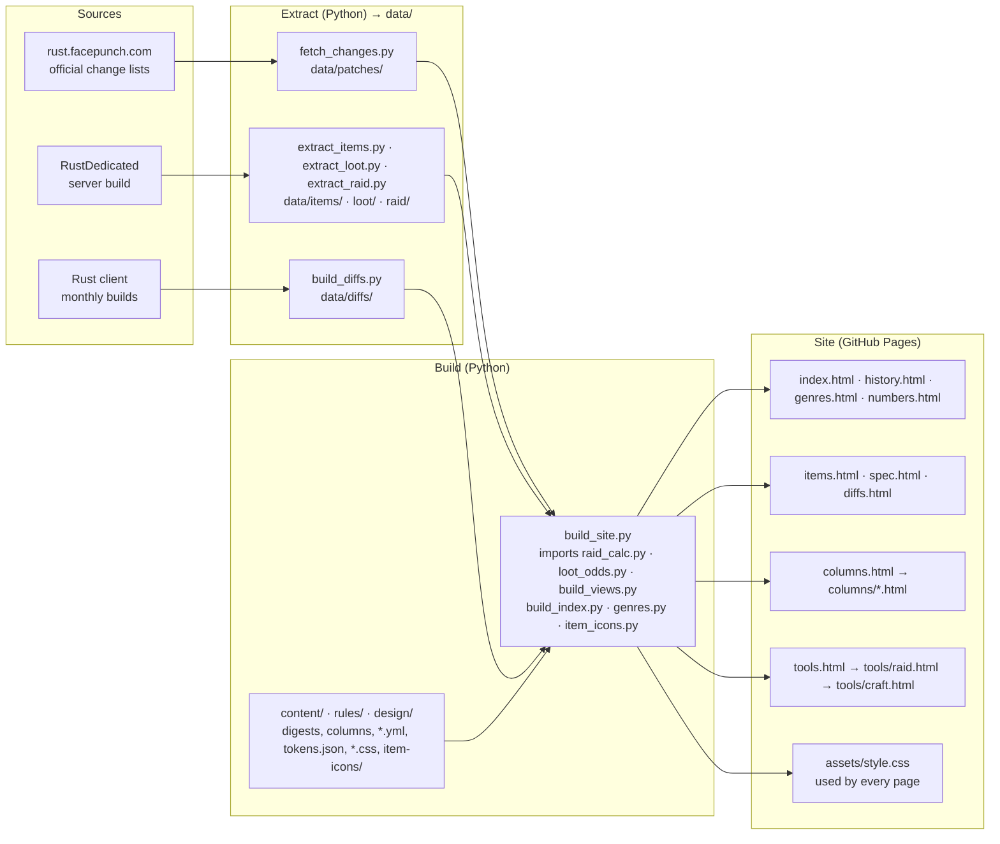

[日本語](README.md) | [English](README.en.md) | [简体中文](README.zh.md) | [한국어](README.ko.md) | **Русский**

# Rust Analysis

Неофициальный сайт одного автора об игре Rust (Facepunch Studios): официальные списки изменений, пересказанные на японском, значения всех предметов и калькуляторы для рейдов и крафта.

**https://maco165.github.io/rust-patch-notes/**

## Устройство системы

Страницы собирают скрипты на Python из данных, прочитанных из игры. Внешних JS-файлов нет: `build_site.py` записывает скрипт каждой страницы прямо в неё.

- С любой страницы через верхнее меню можно попасть на все основные страницы.
- `tools/raid.html` передаёт выбранные количества в `tools/craft.html` через URL (`m`, `o`, `c`, `r`); страница крафта ссылается обратно через `r`.
- `assets/style.css` — это `design/tokens.json` в виде CSS-переменных, затем `components.css`, `site.css` и по одной маске на каждую иконку из `item-icons/`.

## Страницы

| Страница | Что показывает | Источник |
|---|---|---|
| [index.html](index.html) (Только японский) | Обновление этого месяца: главное, количество, изменённые значения, все изменения | Официальные списки изменений, пересказанные на японском |
| [history.html](history.html) · [genres.html](genres.html) · [numbers.html](numbers.html) (Только японский) | Все патчи с фильтром по жанру, году и типу; количество по жанрам; изменения с числами | Те же списки изменений; жанры — правила этого сайта |
| [items.html](items.html) · [spec.html](spec.html) (Только японский) | Настройки каждого предмета, где он выпадает и как часто; все значения в таблицах | Значения, выгруженные из серверной сборки, и шансы, посчитанные по таблицам лута |
| [diffs.html](diffs.html) (Только японский) | Что изменилось в настройках предметов между двумя сборками | Файлы предметов ежемесячных сборок клиента |
| [columns.html](en/columns.html) (English) | Статьи, проверяющие слова игроков по коду и данным сервера | Код сервера (IL) и данные; источники в конце каждой статьи |
| [tools/raid.html](en/tools/raid.html) (English) | Raid Planner: взрывчатка, сера, материалы и время печей, чтобы разрушить стены, двери и постройки вместе | Данные сервера и правила урона и переплавки из кода сервера |
| [tools/craft.html](en/tools/craft.html) (English) | Craft Planner: чего не хватает и сколько работают печи — по тому, что вы делаете, что у вас есть и какие печи | Те же данные, что и у Raid Planner |

## Языки

Инструменты и статьи есть на японском и английском, остальные страницы — только на японском. Списки изменений — это официальный английский текст, пересказанный на японском, поэтому обратно на английский их не переводим: читайте https://rust.facepunch.com/changes.

| Язык | Статус |
|---|---|
| 日本語 | Все страницы |
| English | Инструменты, статьи и этот README |
| 简体中文 | Этот README; страницы планируются |
| 한국어 | Этот README; страницы планируются |
| Русский | Этот README; страницы планируются |

## Важно знать

- Не связан с Facepunch Studios.
- Значения прочитаны из данных и кода игры, а не измерены в игре. Их правильность не гарантируется.
- В этом репозитории только сгенерированные страницы. Не правьте их вручную.
- Часть иконок — из [Lucide](https://lucide.dev/) (ISC License, `LICENSE-lucide.txt`). Иконки и изображения игры не используются.
