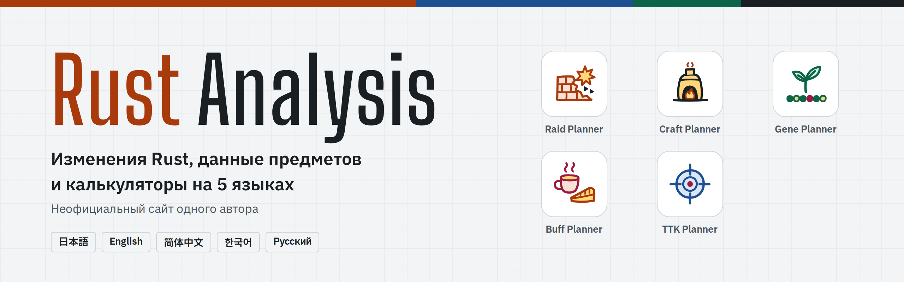
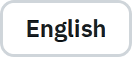
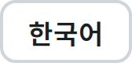
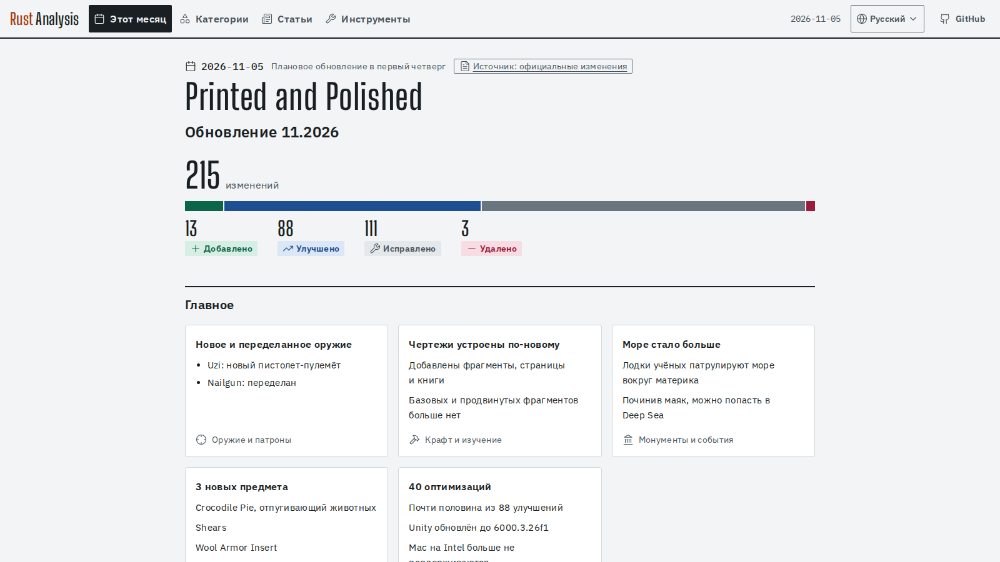
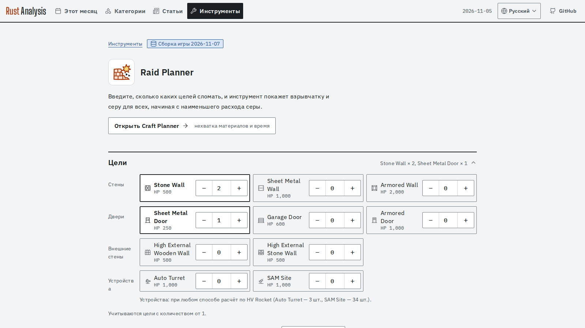
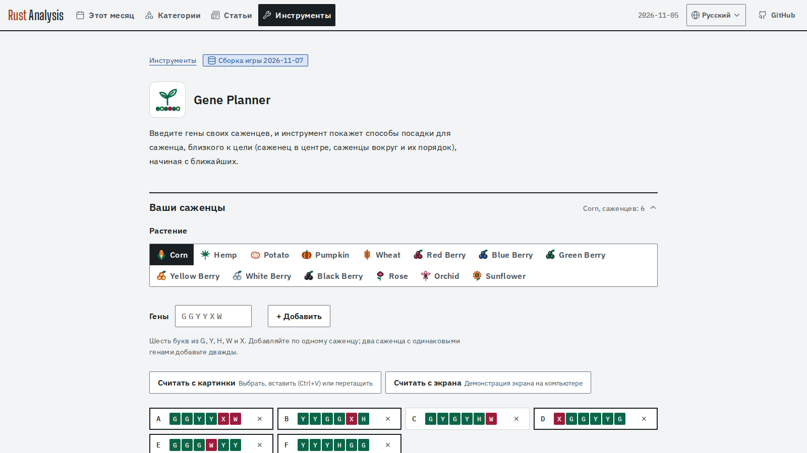
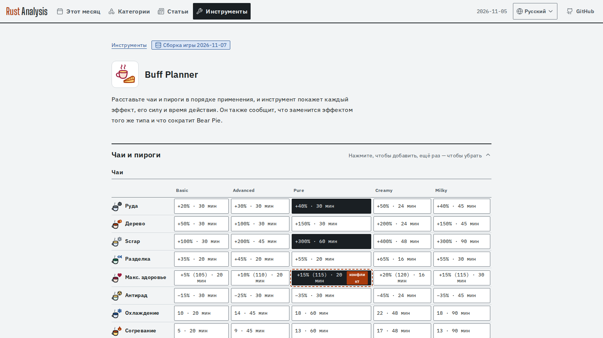
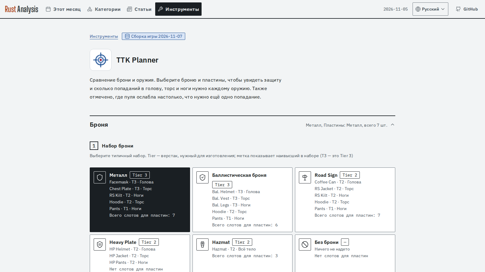
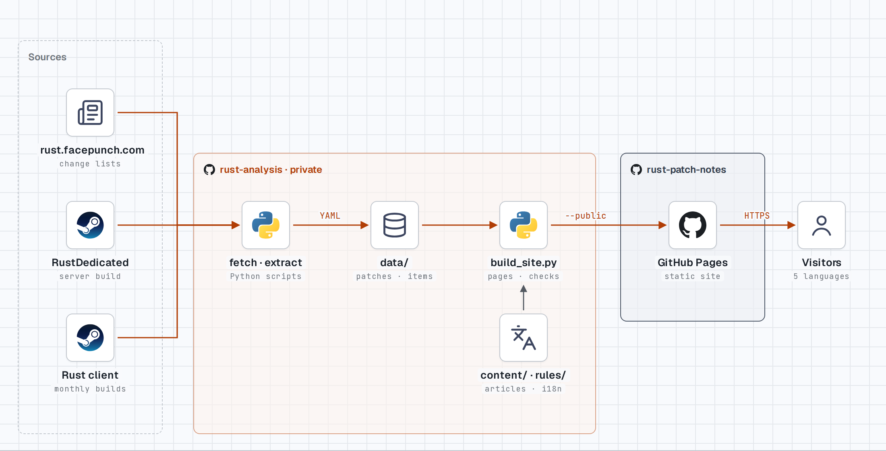
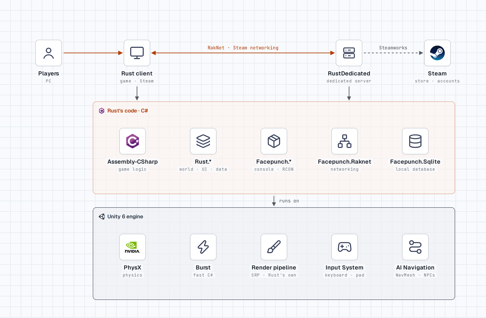

<a href="https://maco165.github.io/rust-patch-notes/ru/index.html"><picture><source media="(prefers-color-scheme: dark)" srcset="assets/readme/hero-ru-dark.png"></picture></a>

    

<b><a href="https://maco165.github.io/rust-patch-notes/ru/index.html">https://maco165.github.io/rust-patch-notes/</a></b>

Неофициальный сайт одного автора об игре Rust (Facepunch Studios): официальные списки изменений, пересказанные на японском, значения всех предметов и пять калькуляторов (рейд, крафт, гены растений, чаи и пироги, число попаданий до смерти). Этот месяц, категории, инструменты и статьи доступны на пяти языках.

## О сайте

**Что это** — Неофициальный аналитический сайт: он читает официальные списки изменений, данные и код самой игры, чтобы проверить, как устроен Rust.

**Зачем** — Не было сайта, который по изменениям в коде игры собирал бы содержание обновлений и внутреннее устройство.

**Сильные стороны**

- Читаем до кода: не только значения, но и код сервера (IL), чтобы проверить правила расчёта; калькуляторы проверены на примерах и полным перебором
- Вся история с 2015 года и ежемесячные обновления: все патчи с 2015 года и различия настроек предметов по месячным сборкам
- Пять языков, только браузер, бесплатно: японский, английский, китайский, корейский и русский, без регистрации и рекламы, всё работает в браузере

**Принцип** — Пишем только то, что проверено. Непроверенное помечаем как неподтверждённое.

**Проверка** — Каждое изменение перед публикацией проверяет по диффу Claude — ИИ от Anthropic, — и одобряет человек.

## Экраны

<table><tr><td colspan="2" valign="top"> <b>Этот месяц</b></td></tr><tr><td width="50%" valign="top"> <b>Raid Planner</b></td><td width="50%" valign="top"> <b>Gene Planner</b></td></tr><tr><td width="50%" valign="top"> <b>Buff Planner</b></td><td width="50%" valign="top"> <b>TTK Planner</b></td></tr></table>

## Устройство системы

<picture><source media="(prefers-color-scheme: dark)" srcset="assets/readme/arch-dark.png"></picture>

## Языки

Этот месяц, категории, инструменты и статьи есть на японском, английском, китайском (упрощённом), корейском и русском, остальные страницы (и список всех изменений месяца) — только на японском. При первом открытии эти страницы переходят на язык браузера (язык, выбранный ссылкой, запоминается). Названия предметов на всех языках — английские названия из игры. Списки изменений — это официальный английский текст, пересказанный на японском, поэтому на другие языки их не переводим: читайте https://rust.facepunch.com/changes.

## Важно знать

- Не связан с Facepunch Studios.
- Значения прочитаны из данных и кода игры, а не измерены в игре. Их правильность не гарантируется.
- В этом репозитории только сгенерированные страницы. Не правьте их вручную.
- Часть иконок — из [Lucide](https://lucide.dev/) (ISC License, `LICENSE-lucide.txt`). Иконки и изображения игры не используются.
- Логотипы на схеме — товарные знаки их владельцев (иконки: svgl, Lucide; схема сделана stack-diagram).

## Об игре Rust

Rust — многопользовательская игра на выживание от Facepunch Studios. Вы начинаете на берегу с одним камнем в руках, добываете ресурсы, создаёте инструменты, строите базу и объединяетесь с другими игроками или сражаетесь с ними. Игра вышла в раннем доступе в 2013 году и полностью — в 2018-м. Игра и сервер написаны на C# на движке Unity. В первый четверг каждого месяца выходит крупное обновление, и этот сайт следит за этими изменениями. Версия для ПК — в Steam, для PlayStation и Xbox есть Rust Console Edition.

### На чём работает

<picture><source media="(prefers-color-scheme: dark)" srcset="assets/readme/engine-dark.png"></picture>

Игра и сервер — программы на C# поверх Unity 6. Проверено по сборкам C# (DLL) выделенного сервера (RustDedicated, сборка 2026-10-22); версия Unity — из официального списка изменений (2026-11-05: 6000.3.26f1).

### Официальные ссылки

- [Официальный сайт: rust.facepunch.com](https://rust.facepunch.com/)
- [Обновления (официальные изменения)](https://rust.facepunch.com/changes)
- [Новости](https://rust.facepunch.com/news)
- [Журнал коммитов разработки](https://commits.facepunch.com/r/rust_reboot)

