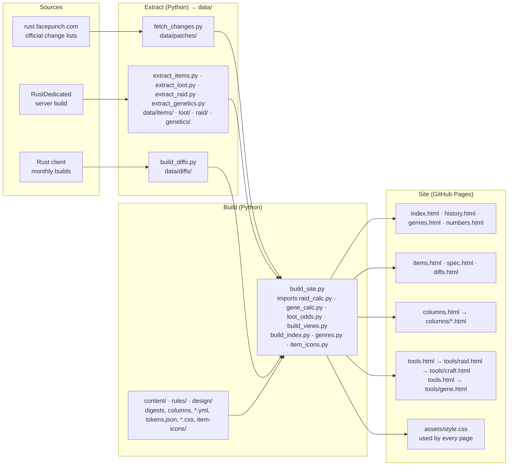

[日本語](README.md) | [English](README.en.md) | **简体中文** | [한국어](README.ko.md) | [Русский](README.ru.md)

# Rust Analysis

关于游戏 Rust (Facepunch Studios) 的非官方个人网站：用日语整理官方更新日志，列出所有物品的数值，并提供突袭与制作的计算器。

**https://maco165.github.io/rust-patch-notes/**

## 系统结构

页面由 Python 脚本根据从游戏中读取的数据生成。没有外部 JS 文件：`build_site.py` 把每个页面的脚本直接写进页面里。

- 每个页面都可以通过顶部导航栏前往所有主要页面。
- `tools/raid.html` 通过 URL (`m`、`o`、`c`、`r`) 把选好的数量传给 `tools/craft.html`；制作页面用 `r` 链接回去。
- `assets/style.css` 由 `design/tokens.json` 转成的 CSS 变量、`components.css`、`site.css` 以及 `item-icons/` 中每个图标的遮罩组成。

## 页面

| 页面 | 内容 | 数据来源 |
|---|---|---|
| [index.html](index.html) (仅日语) | 本月更新：要点、数量、数值变化、全部改动 | 官方更新日志，用日语重写 |
| [history.html](history.html) · [genres.html](genres.html) · [numbers.html](numbers.html) (仅日语) | 所有补丁（可按类别、年份、种类筛选）；各类别的数量；写有数值的改动 | 同一份更新日志；类别划分是本站自己的规则 |
| [items.html](items.html) · [spec.html](spec.html) (仅日语) | 每个物品的设置、掉落位置与概率；所有数值的表格 | 从服务器版本导出的数值，以及根据掉落表算出的概率 |
| [diffs.html](diffs.html) (仅日语) | 两个版本之间物品设置的变化 | 客户端每月版本的物品文件 |
| [columns.html](en/columns.html) (English) | 根据服务器代码和数据验证玩家说法的文章 | 服务器的代码 (IL) 与数据；出处在每篇文章末尾 |
| [tools/raid.html](en/tools/raid.html) (English) | Raid Planner：同时摧毁墙、门和设施所需的炸药、硫磺、材料和熔炉时间 | 服务器数据，以及从服务器代码读出的伤害与冶炼规则 |
| [tools/craft.html](en/tools/craft.html) (English) | Craft Planner：根据要制作的东西、持有的物资和熔炉，算出还缺什么、熔炉要多久 | 与 Raid Planner 相同的数据 |
| [tools/gene.html](tools/gene.html) (仅日语) | Gene Planner：用手上的幼苗种出接近 GGGYYY 等目标基因的种法，以及基因的效果 | 服务器数据，以及从服务器代码读出的杂交规则 |

## 语言

工具和文章有日语和英语版本，其他页面只有日语。更新日志是把官方英文改写成日语的，因此不会再译回英文：请阅读 https://rust.facepunch.com/changes 。

| 语言 | 状态 |
|---|---|
| 日本語 | 全部页面 |
| English | 工具、文章和本 README |
| 简体中文 | 本 README；页面计划支持 |
| 한국어 | 本 README；页面计划支持 |
| Русский | 本 README；页面计划支持 |

## 须知

- 与 Facepunch Studios 无关。
- 数值是从游戏的数据和代码中读出的，并非在游戏里实测，不保证正确。
- 本仓库只存放生成的页面，请不要手动修改。
- 部分图标来自 [Lucide](https://lucide.dev/)（ISC License，`LICENSE-lucide.txt`）。未使用游戏的图标或图片。
