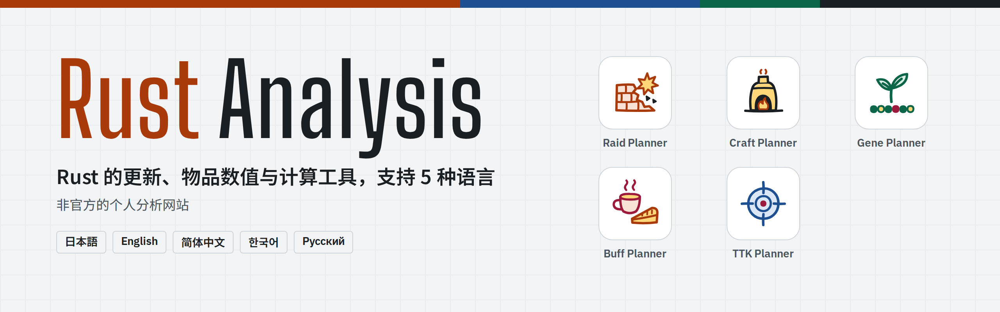
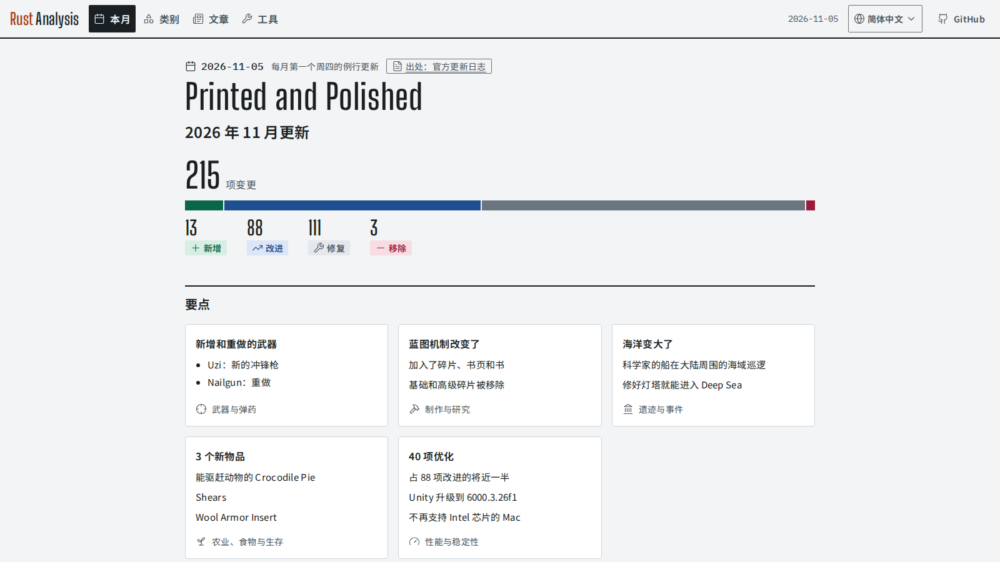
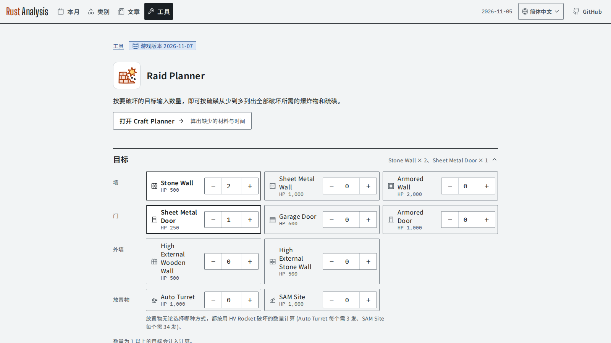
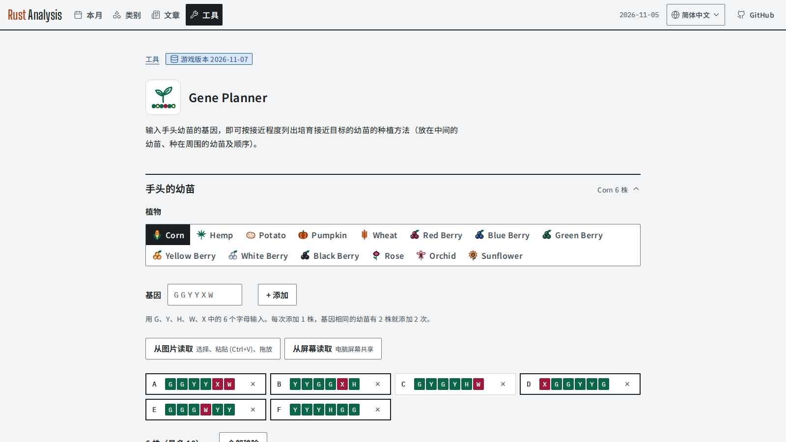
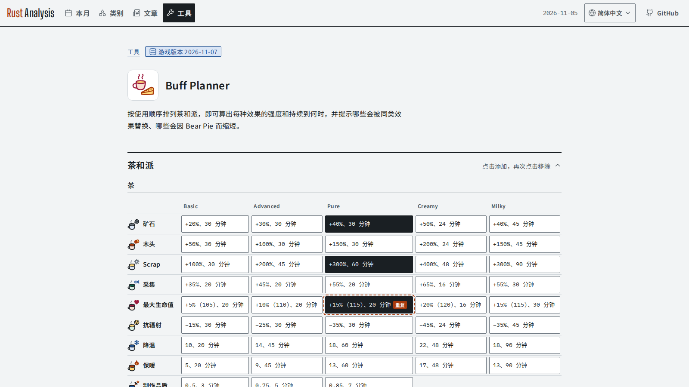
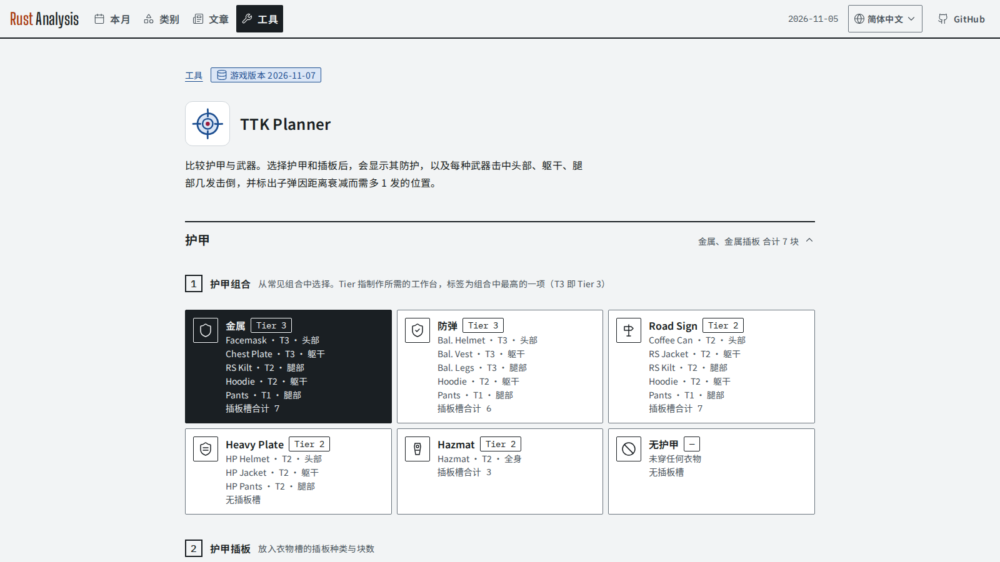
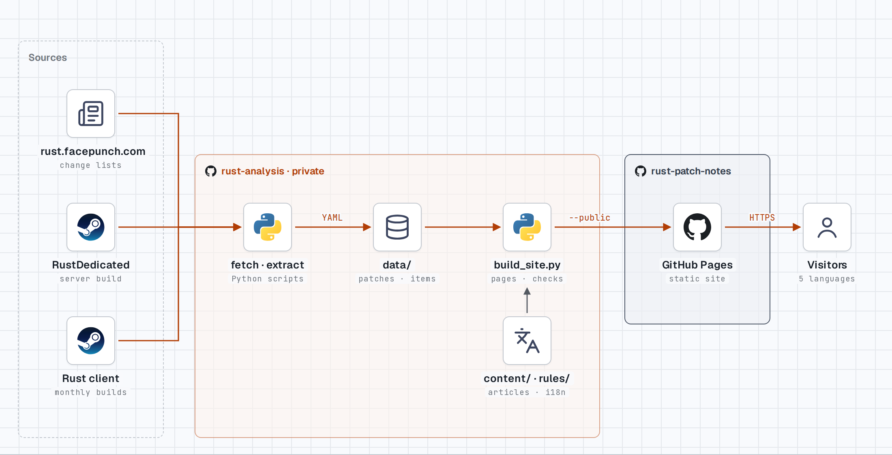
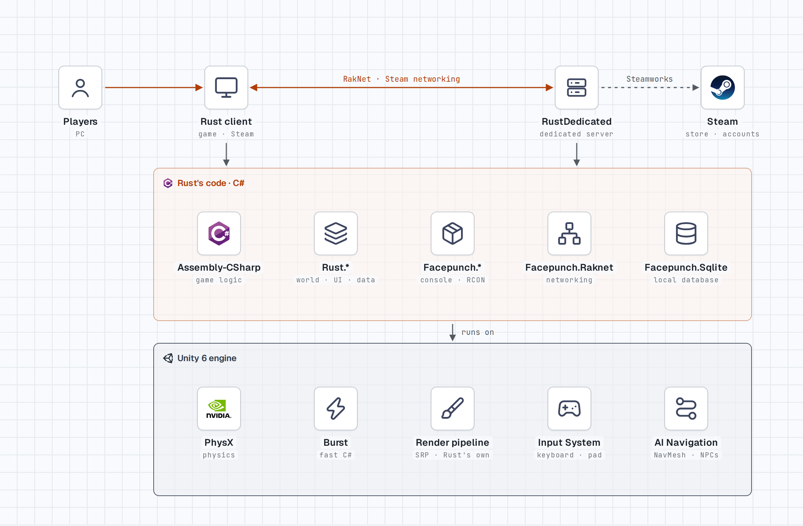

<a href="https://maco165.github.io/rust-patch-notes/zh/index.html"><picture><source media="(prefers-color-scheme: dark)" srcset="assets/readme/hero-zh-dark.png"></picture></a>

    

<b><a href="https://maco165.github.io/rust-patch-notes/zh/index.html">https://maco165.github.io/rust-patch-notes/</a></b>

关于游戏 Rust (Facepunch Studios) 的非官方个人网站：用日语整理官方更新日志，列出所有物品的数值，并提供 5 个计算器（抄家、制作、植物基因、茶与派、几发击倒）。本月、类别、工具和文章支持 5 种语言。

## 关于本站

**是什么** — 阅读官方更新日志以及游戏本体的数据和代码，来确认 Rust 运作方式的非官方分析网站。

**为什么做** — 此前没有一个网站从游戏代码的变化中整理更新内容和内部机制。

**优势**

- 读到代码为止：不只看数值，还读服务器代码 (IL) 来确认计算规则，计算器用例题和穷举来检验
- 2015 年以来的全部历史并每月更新：2015 年以来的全部变更，以及按月版本比较的物品设置差异
- 5 种语言、只需浏览器、免费：支持日语、英语、中文、韩语和俄语，无需注册、没有广告，全部在浏览器中运行

**理念** — 只写确认过的内容。未确认的内容会标明“未确认”。

**审核** — 每项变更在公开前都由 Anthropic 的 AI“Claude”检查差异，并经人工批准。

## 页面

| 页面 | 内容 | 语言 |
|---|---|---|
| [本月](https://maco165.github.io/rust-patch-notes/zh/index.html) | 本月更新的要点、数量、类别和物品设置的差异 | JP EN CN KR RU |
| [历史](https://maco165.github.io/rust-patch-notes/history.html) | 2015 年以来的全部变更，可按类别、年份、分类和关键词筛选 | JP only |
| [类别](https://maco165.github.io/rust-patch-notes/zh/genres.html) | 各类别的变更数量及逐年变化 | JP EN CN KR RU |
| [数值](https://maco165.github.io/rust-patch-notes/numbers.html) | 官方文字中写有前后数值或比例的变更 | JP only |
| [版本差异](https://maco165.github.io/rust-patch-notes/diffs.html) | 选择两个版本，查看物品设置变了多少 | JP only |
| [物品](https://maco165.github.io/rust-patch-notes/items.html) | 每个物品的设置、掉落来源与概率、变更历史 | JP only |
| [规格表](https://maco165.github.io/rust-patch-notes/spec.html) | 按种类整理的全部物品数值 | JP only |
| [文章](https://maco165.github.io/rust-patch-notes/zh/columns.html) | 用服务器代码和数据验证玩家说法的文章 | JP EN CN KR RU |

### 工具

| 工具 | 用途 | 语言 |
|---|---|---|
| [Raid Planner](https://maco165.github.io/rust-patch-notes/zh/tools/raid.html) | 一起破坏墙、门和放置物所需的爆炸物数量、硫磺和材料 | JP EN CN KR RU |
| [Craft Planner](https://maco165.github.io/rust-patch-notes/zh/tools/craft.html) | 根据要做的爆炸物和手头物资，算出缺少的材料和熔炉时间 | JP EN CN KR RU |
| [Gene Planner](https://maco165.github.io/rust-patch-notes/zh/tools/gene.html) | 用手头的幼苗接近目标基因的种法 | JP EN CN KR RU |
| [Buff Planner](https://maco165.github.io/rust-patch-notes/zh/tools/buff.html) | 茶和派的效果如何叠加、何时结束 | JP EN CN KR RU |
| [TTK Planner](https://maco165.github.io/rust-patch-notes/zh/tools/ttk.html) | 按护甲和武器算出几发击倒 | JP EN CN KR RU |

## 页面截图

<table><tr><td colspan="2" valign="top"> <b>本月</b></td></tr><tr><td width="50%" valign="top"> <b>Raid Planner</b></td><td width="50%" valign="top"> <b>Gene Planner</b></td></tr><tr><td width="50%" valign="top"> <b>Buff Planner</b></td><td width="50%" valign="top"> <b>TTK Planner</b></td></tr></table>

## 系统结构

<picture><source media="(prefers-color-scheme: dark)" srcset="assets/readme/arch-dark.png"></picture>

## 语言

本月、类别、工具和文章有日语、英语、简体中文、韩语和俄语版本，其他页面（以及本月的全部变更列表）只有日语。第一次打开这些页面时，会跳转到浏览器语言的版本（用语言链接选择后，会记住所选语言）。物品名称在所有语言中都使用游戏的英文名称。更新日志是把官方英文改写成日语的，因此不会再译回其他语言：请阅读 https://rust.facepunch.com/changes 。

## 须知

- 与 Facepunch Studios 无关。
- 数值是从游戏的数据和代码中读出的，并非在游戏里实测，不保证正确。
- 本仓库只存放生成的页面，请不要手动修改。
- 部分图标来自 [Lucide](https://lucide.dev/)（ISC License，`LICENSE-lucide.txt`）。未使用游戏的图标或图片。
- 结构图中的标志是各自所有者的商标（图标：svgl、Lucide；用 stack-diagram 绘制）。

## 关于游戏 Rust

Rust 是 Facepunch Studios 开发的多人生存游戏。玩家从海滩开始，手里只有一块石头，需要收集资源、制作工具、建造基地，并与其他玩家合作或争夺。游戏于 2013 年开始抢先体验，2018 年正式发售。游戏和服务器都是在 Unity 引擎上用 C# 编写的。每月第一个星期四会有大型更新，本站追踪这些变化。PC 版在 Steam 上发售，PlayStation 和 Xbox 平台则有 Rust Console Edition。

### 运行在什么之上

<picture><source media="(prefers-color-scheme: dark)" srcset="assets/readme/engine-dark.png"></picture>

游戏和服务器都是运行在 Unity 6 上的 C# 程序。本图根据专用服务器 (RustDedicated，2026-10-22 版本) 的 C# 组件 (DLL) 确认，Unity 版本来自官方更新日志 (2026-11-05：6000.3.26f1)。

### 官方链接

- [官方网站: rust.facepunch.com](https://rust.facepunch.com/)
- [更新信息 (官方更新日志)](https://rust.facepunch.com/changes)
- [新闻](https://rust.facepunch.com/news)
- [开发提交记录](https://commits.facepunch.com/r/rust_reboot)

